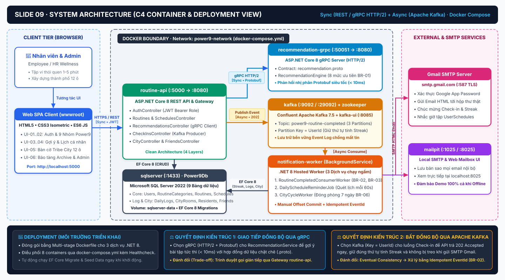
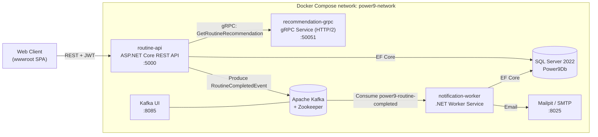

# Power9 Office Routine & Tribe City

> PRN232 – Final Assignment · Ứng dụng phân tán trên nền tảng .NET 8

## 1. Mô tả dự án

**Power9** giúp nhân viên văn phòng xây dựng các *vi thói quen* sức khỏe ngắn (1–5 phút), dựa trên 9 nguyên lý sống thọ Blue Zones: giãn cơ khi ngồi lâu, hít thở giảm stress, uống nước, kết nối đồng nghiệp…

Tính năng chính:

- **Thư viện bài tập (Routine)** chia theo 9 nhóm, có tìm kiếm, lọc theo nhóm và phân trang.
- **Lịch nhắc cá nhân**: nhân viên tự đặt giờ và các thứ trong tuần. Hệ thống tự gửi email nhắc khi đến giờ.
- **Check-in hoàn thành bài tập**: cộng điểm thưởng, tính chuỗi ngày liên tiếp (Streak), gửi email chúc mừng. Toàn bộ được xử lý **bất đồng bộ qua Kafka**.
- **Gợi ý bài tập thông minh** (gRPC): dựa trên số phút đã ngồi, buổi trong ngày và mức stress.
- **Tribe City (gamification)**: tối đa 12 đồng nghiệp cùng xây một thành phố trong chu kỳ 7 ngày. Mỗi lần check-in nhận vật liệu để nâng tầng nhà. Có kết bạn, tương tác và lưu trữ thành phố đã kết thúc.

Vai trò người dùng: `Employee` (nhân viên) và `Admin` (HR / quản trị nội dung).

## 2. Kiến trúc hệ thống





### Các thành phần

| Service | Project | Vai trò |
|---|---|---|
| **REST API** | `src/Services/RoutineService` | API chính, xác thực JWT, CRUD, gateway REST → gRPC, Kafka **producer**, phục vụ Web UI tĩnh |
| **gRPC Service** | `src/Services/RecommendationService` | Service độc lập gợi ý bài tập theo thể trạng (Protobuf contract: `src/Common/Power9.GrpcContracts/Protos/recommendation.proto`) |
| **Background Worker** | `src/Services/NotificationWorkerService` | Kafka **consumer** + các job chạy định kỳ + gửi email |
| **Common** | `src/Common/Power9.Common` | Kafka producer dùng chung, định nghĩa event, tên topic |

### REST API: kiến trúc phân lớp (Clean Architecture)

```
Power9.RoutineService.Api             → Controllers, Swagger, JWT, DI, cấu hình
Power9.RoutineService.Application     → DTOs, Service interfaces & business logic (AuthService, RoutineService, ScheduleService)
Power9.RoutineService.Infrastructure  → EF Core DbContext, Migrations, Repositories, Seed data
Power9.RoutineService.Domain          → Entities & Enums
```

### Background jobs (`Power9.NotificationWorker`)

| Worker | Loại | Mô tả |
|---|---|---|
| `RoutineCompletedConsumerWorker` | Asynchronous (Kafka consumer) | Nhận `RoutineCompletedEvent`, cộng điểm, tính Streak, ghi `DailyLogs`, cộng vật liệu Tribe City, gửi email chúc mừng. Commit offset thủ công sau khi lưu DB (at-least-once), chống xử lý trùng bằng `EventId`. |
| `DailyScheduleReminderJob` | Scheduled (`PeriodicTimer`, mặc định 60s) | Quét `UserSchedules` và gửi email nhắc khi đến giờ (theo giờ Việt Nam). |
| `CityCycleWorker` | Scheduled (60s) | Đóng các thành phố Tribe City đã hết chu kỳ 7 ngày và chuyển sang Archive. |

### Luồng nghiệp vụ end-to-end (check-in)

1. Người dùng đăng nhập (`POST /api/auth/login`) và nhận JWT.
2. Bấm **Gợi ý** → `GET /api/recommendations/smart-suggest`. REST API gọi gRPC `GetRoutineRecommendation` và trả về bài tập phù hợp.
3. Tập xong, bấm **Check-in** → `POST /api/routines/{id}/checkin`. API publish `RoutineCompletedEvent` lên topic `power9-routine-completed` (key = UserId để giữ thứ tự theo user) và trả về ngay `202 Accepted`.
4. `notification-worker` consume event → cập nhật điểm, Streak, `DailyLogs`, Tribe City → gửi email.
5. Theo dõi message tại Kafka UI (`http://localhost:8085`), email tại Mailpit (`http://localhost:8025`), log tại `docker compose logs -f notification-worker`.

## 3. Công nghệ sử dụng

| Hạng mục | Công nghệ |
|---|---|
| Nền tảng | .NET 8, ASP.NET Core Web API, .NET Worker Service |
| ORM / Database | Entity Framework Core 8 (Code-First Migrations), SQL Server 2022 |
| Xác thực | JWT Bearer (HMAC-SHA256), mật khẩu băm PBKDF2-SHA256 |
| Inter-service (đồng bộ) | gRPC (`Grpc.AspNetCore.Server`, `Grpc.Net.ClientFactory`, `Grpc.Tools`), Protocol Buffers |
| Message Broker | Apache Kafka (Confluent 7.5) + Zookeeper, client `Confluent.Kafka`, Kafka UI |
| Email | SMTP (Gmail / Mailpit cho môi trường dev) |
| API Docs | Swagger / OpenAPI (Swashbuckle) |
| Containerization | Docker, Docker Compose |
| Testing | xUnit |
| Frontend | HTML / CSS / JavaScript thuần (phục vụ từ `wwwroot`) |

Xem [công nghệ và lý do lựa chọn trong Power9](docs/cong_nghe_va_ly_do_su_dung.md) để biết từng thành phần được dùng ở đâu trong luồng gợi ý, nhắc lịch và check-in.

## 4. Cấu trúc thư mục

```
PRN232_Power9/
├── docker-compose.yml
├── Power9.slnx
├── docs/                                   # Tài liệu thiết kế, sơ đồ (PlantUML/SVG), slide
├── src/
│   ├── Common/
│   │   ├── Power9.Common/                  # KafkaProducer, Events, KafkaTopics
│   │   └── Power9.GrpcContracts/           # recommendation.proto
│   └── Services/
│       ├── RoutineService/                 # REST API (Api / Application / Domain / Infrastructure) + Dockerfile
│       ├── RecommendationService/          # gRPC service + Dockerfile
│       └── NotificationWorkerService/      # Background worker + Dockerfile
└── tests/
    ├── Power9.NotificationWorker.Tests/
    └── Power9.RecommendationGrpc.Tests/
```

## 5. Hướng dẫn cài đặt

### Yêu cầu

- [Docker Desktop](https://www.docker.com/products/docker-desktop/) (bao gồm Docker Compose v2)
- *(Tuỳ chọn, để chạy không qua Docker)* [.NET 8 SDK](https://dotnet.microsoft.com/download/dotnet/8.0). File `Power9.slnx` cần **.NET SDK 9.0.200 trở lên** hoặc Visual Studio 2022 17.13+. Nếu dùng SDK 8, hãy build từng project `.csproj`.
- *(Tuỳ chọn)* `dotnet-ef` để quản lý migration: `dotnet tool install --global dotnet-ef`

### Clone mã nguồn

```bash
git clone <repository-url>
cd PRN232_Power9
```

### Cấu hình

Cấu hình nằm trong `appsettings.json` của từng service và **được ghi đè bằng biến môi trường** trong `docker-compose.yml` (cú pháp `Section__Key`).

| Khoá | Ý nghĩa | Mặc định |
|---|---|---|
| `ConnectionStrings:DefaultConnection` | Chuỗi kết nối SQL Server | `Server=localhost,1433;Database=Power9Db;User Id=sa;Password=Password123!;TrustServerCertificate=True;` |
| `Jwt:Key` / `Jwt:Issuer` / `Jwt:Audience` | Ký và xác thực JWT (Key ≥ 32 byte) | xem `appsettings.json` |
| `Kafka:BootstrapServers` | Địa chỉ Kafka | `localhost:9092` (host) · `kafka:29092` (Docker) |
| `Kafka:GroupId` | Consumer group của worker | `power9-worker-group` |
| `GrpcServices:RecommendationUrl` | Địa chỉ gRPC service | `http://localhost:50051` |
| `Reminder:IntervalSeconds` | Chu kỳ quét lịch nhắc | `60` |
| `Smtp:Host` / `Port` / `EnableSsl` / `Username` / `Password` / `SenderName` | Cấu hình gửi email | Docker: `mailpit:1025` |
| `SA_PASSWORD` (biến môi trường của Compose) | Mật khẩu `sa` của SQL Server | `Password123!` |

> ⚠️ Không commit mật khẩu thật (SMTP, JWT key production) vào repo. Hãy đặt chúng qua biến môi trường, file `.env` (nhớ thêm `.env` vào `.gitignore`) hoặc `dotnet user-secrets`. Nếu dùng Gmail SMTP, phải tạo **App Password** tại <https://myaccount.google.com/apppasswords>.

### Database & Migrations

- Migrations nằm trong `src/Services/RoutineService/Power9.RoutineService.Infrastructure/Migrations`.
- Khi khởi động, REST API **tự động** chạy `Database.MigrateAsync()` và seed dữ liệu mẫu (9 nhóm thói quen, các bài tập, tài khoản demo, một thành phố Tribe City mẫu).
- Chạy migration thủ công hoặc tạo migration mới:

```bash
dotnet ef database update \
  --project src/Services/RoutineService/Power9.RoutineService.Infrastructure \
  --startup-project src/Services/RoutineService/Power9.RoutineService.Api

dotnet ef migrations add <TenMigration> \
  --project src/Services/RoutineService/Power9.RoutineService.Infrastructure \
  --startup-project src/Services/RoutineService/Power9.RoutineService.Api
```

- Xuất SQL script (nộp kèm deliverable):

```bash
dotnet ef migrations script --idempotent -o docs/database.sql \
  --project src/Services/RoutineService/Power9.RoutineService.Infrastructure \
  --startup-project src/Services/RoutineService/Power9.RoutineService.Api
```

## 6. Hướng dẫn triển khai (Deployment)

### Cách 1: Docker Compose (khuyến nghị)

```bash
# Build image và khởi chạy toàn bộ hệ thống
docker compose up -d --build

# Kiểm tra trạng thái (kafka-init chạy một lần rồi thoát với Exited (0) là bình thường)
docker compose ps

# Xem log từng service
docker compose logs -f routine-api
docker compose logs -f notification-worker
docker compose logs -f recommendation-grpc

# Dừng hệ thống (thêm -v để xoá luôn dữ liệu SQL Server)
docker compose down
```

Thứ tự khởi động được đảm bảo bằng `depends_on` + `healthcheck`: SQL Server và Kafka healthy → `kafka-init` tạo topic → `routine-api` / `notification-worker` khởi động.

| Thành phần | Container | URL / Cổng (host) |
|---|---|---|
| Web UI | `power9-routine-api` | <http://localhost:5000> |
| Swagger UI | `power9-routine-api` | <http://localhost:5000/swagger> |
| gRPC Recommendation | `power9-recommendation-grpc` | `localhost:50051` (HTTP/2, h2c) |
| SQL Server | `power9-sqlserver` | `localhost,1433` (user `sa`) |
| Kafka (từ host) | `power9-kafka` | `localhost:9092` (trong Docker: `kafka:29092`) |
| Kafka UI | `power9-kafka-ui` | <http://localhost:8085> |
| Mailpit (hộp thư test) | `power9-mailpit` | <http://localhost:8025> (SMTP `1025`) |

Kafka topics được tạo sẵn: `power9-routine-completed` (3 partitions), `power9-routine-proposals`.

### Cách 2: Chạy local bằng `dotnet run`

Chỉ chạy hạ tầng bằng Docker, còn các service .NET chạy trên máy:

```bash
docker compose up -d sqlserver zookeeper kafka kafka-init kafka-ui mailpit

# Mỗi lệnh chạy trong một terminal riêng
dotnet run --project src/Services/RecommendationService/Power9.RecommendationGrpc     # http://localhost:50051
dotnet run --project src/Services/RoutineService/Power9.RoutineService.Api            # http://localhost:5000
dotnet run --project src/Services/NotificationWorkerService/Power9.NotificationWorker
```

Khi chạy local, worker đọc `Smtp` từ `appsettings*.json`. Để email đổ về Mailpit, đặt `Smtp__Host=localhost`, `Smtp__Port=1025`, `Smtp__EnableSsl=false`.

### Cách 3: Public cloud

Mỗi service đã có `Dockerfile` riêng (build context là thư mục gốc repo) nên có thể deploy lên Azure Container Apps, Render, Railway… Cần cung cấp SQL Server, Kafka (managed hoặc container) và cấu hình các biến môi trường như bảng ở mục 5.

## 7. API Documentation

Swagger UI: **<http://localhost:5000/swagger>** (bật ở môi trường `Development`, Docker Compose đang đặt sẵn `ASPNETCORE_ENVIRONMENT=Development`).

Cách dùng: gọi `POST /api/auth/login`, copy `token`, bấm **Authorize** và dán token (không cần tiền tố `Bearer`).

### Tài khoản demo (seed sẵn)

| Vai trò | Email | Mật khẩu |
|---|---|---|
| Admin | `admin@power9.com` | `Admin@123` |
| Employee | `nam.le@power9.com`, `lan.nguyen@power9.com`, `duc.hoang@power9.com`, `an.pham@power9.com` | `User@123` |

### Danh sách endpoint chính

| Method | Endpoint | Auth | Mô tả |
|---|---|---|---|
| POST | `/api/auth/register` | – | Đăng ký tài khoản Employee |
| POST | `/api/auth/login` | – | Đăng nhập, nhận JWT |
| GET | `/api/categories` | – | Danh sách 9 nhóm thói quen |
| GET | `/api/routines?searchKeyword=&categoryId=&pageNumber=1&pageSize=10` | – | Tìm kiếm, lọc, phân trang bài tập |
| GET | `/api/routines/{id}` | – | Chi tiết bài tập |
| POST | `/api/routines` | JWT | Tạo bài tập |
| PUT | `/api/routines/{id}` | Admin | Cập nhật bài tập |
| DELETE | `/api/routines/{id}` | Admin | Xoá bài tập |
| POST | `/api/routines/{routineId}/checkin` | JWT | Check-in → publish Kafka event, trả `202 Accepted` |
| GET | `/api/schedules/my-schedules` | JWT | Lịch nhắc của tôi |
| POST / PUT / DELETE | `/api/schedules`, `/api/schedules/{id}` | JWT | CRUD lịch nhắc |
| GET | `/api/recommendations/smart-suggest?sittingMinutes=90&timeOfDay=Afternoon&stressLevel=High` | JWT | REST → gRPC gợi ý bài tập |
| GET | `/api/city/current`, `/api/city/public-rooms`, `/api/city/archive`, `/api/city/{id}`, `/api/city/code/{code}` | JWT | Truy vấn Tribe City |
| POST | `/api/city/create`, `/api/city/quick-match`, `/api/city/join`, `/api/city/{id}/interact`, `/api/city/{id}/upgrade`, `/api/city/{id}/leave` | JWT | Thao tác Tribe City |
| PUT | `/api/city/{id}/toggle-privacy`, `/api/city/{id}/rooftop-status`, `/api/city/{id}/admin-override` | JWT | Cấu hình thành phố |
| GET / POST | `/api/friends`, `/api/friends/request`, `/api/friends/{id}/accept` | JWT | Kết bạn |

Có thể test nhanh bằng file `src/Services/RoutineService/Power9.RoutineService.Api/Power9.RoutineService.Api.http` (VS Code REST Client / Visual Studio / Rider).

### gRPC contract

```proto
service RecommendationProtoService {
  rpc GetRoutineRecommendation (RecommendationRequest) returns (RecommendationReply);
}
```

Gọi trực tiếp bằng [grpcurl](https://github.com/fullstorydev/grpcurl):

```bash
grpcurl -plaintext -import-path src/Common/Power9.GrpcContracts/Protos -proto recommendation.proto \
  -d '{"user_id":1,"sitting_minutes":120,"current_time_of_day":"Afternoon","stress_level":"High"}' \
  localhost:50051 power9.RecommendationProtoService/GetRoutineRecommendation
```

## 8. Kiểm thử

```bash
dotnet test tests/Power9.NotificationWorker.Tests
dotnet test tests/Power9.RecommendationGrpc.Tests
```

Các test bao phủ: thuật toán gợi ý của gRPC engine, tính Streak, logic lịch nhắc (`IsDue`) và các quy tắc Tribe City.

## 9. Tài liệu thiết kế

Các sơ đồ trong [`docs/diagrams`](docs/diagrams):

- Business flow: `slide07_business_flow.svg`
- System architecture: `slide09_system_architecture.svg`
- Sequence diagram: `slide12_sequence_diagram.svg`
- Class design: `slide13_class_design.svg`
- Conceptual ERD: `slide14_conceptual_erd.svg`
- Logical/Physical DB: `slide15_logical_physical_db.svg`
