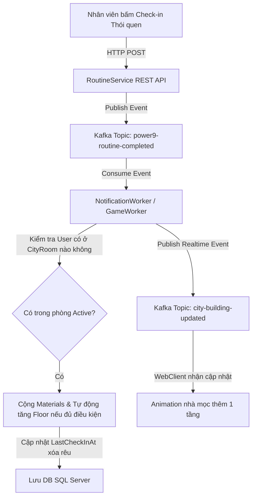

# KẾ HOẠCH TRIỂN KHAI MINI-GAME: TRIBE CITY (THÀNH PHỐ THÓI QUEN 7 NGÀY)
> **Nguyên lý số 9: Right Tribe (Bộ tộc phù hợp - Môi trường thúc đẩy lẫn nhau)**

---

## 1. TỔNG QUAN TÍNH NĂNG (GAMEPLAY & RULES)

* **Quy mô thành phố:** Một bố cục gồm **12 slot** (cho tối đa 12 cư dân/nhân viên, có thể bố trí theo lưới $3 \times 4$ hoặc bố trí 12 lô đất bao quanh công viên trung tâm).
* **Chu kỳ sống:** Đúng **7 ngày (168 giờ)** kể từ thời điểm phòng được tạo. Hết 7 ngày, thành phố đóng lại và chuyển vào **Bảo tàng Kỷ niệm (Hall of Fame / Archive)**.
* **Cơ chế tham gia:**
  * **Tạo phòng (Create Room):** Chủ phòng tạo phòng với chế độ **Public** hoặc **Private** (có thể đổi qua lại bất kỳ lúc nào nếu là chủ phòng). Game tính giờ ngay khi phòng được tạo (1 người cũng chạy).
  * **Ghép nhanh (Quick Match):** Tự động tìm phòng **Public** còn slot và còn thời gian chơi để đưa vào. Nếu không có phòng nào thỏa mãn -> Tự động tạo một phòng Public mới.
  * **Late Join & Rời phòng:** Người chơi khác có thể vào phòng sau khi game đã bắt đầu (miễn là còn slot). Khi người chơi rời phòng, slot và ngôi nhà cũ vẫn được giữ nguyên vị trí (không bị mất slot của thành phố, tránh làm hỏng bố cục thành phố).
  * **Mời bạn & Mã phòng:** Chủ phòng/Thành viên có thể copy Mã phòng (Room Code/Link) hoặc bấm mời bạn bè từ danh sách Friend.
* **Cơ chế xây nhà & Vật liệu (Building & Materials):**
  * Nhân viên hoàn thành thói quen (uống nước, bài tập, nghỉ ngơi, v.v.) qua Check-in sẽ nhận **Vật liệu xây dựng (Bricks / Wood / Glass)** và điểm kinh nghiệm (XP).
  * Đủ định mức vật liệu -> Xây thêm **+1 Tầng (Floor)** cho ngôi nhà của mình.
  * **Hiệu ứng mọc rêu (Moss / Cobwebs):** Nếu qua 24 giờ mà nhân viên không check-in bất kỳ thói quen nào, ngôi nhà sẽ bị phủ một lớp rêu phong/bụi mờ để nhắc nhở.
  * **Trạng thái nóc nhà (Rooftop Status Message):** Mỗi người chơi có thể đặt 1 câu status ngắn (tối đa 50 ký tự, ví dụ: *"Đang cày deadline"*, *"Hôm nay quyết tâm uống 2L nước"*), hiển thị như một bảng hiệu/bong bóng chat trên nóc nhà.
* **Tương tác xã hội nội bộ (Interactions):**
  * Xem chi tiết nhà của đồng nghiệp trong thành phố.
  * Thả tim (Like/Kudos), bấm chuông "Nhắc nhở / Giục" đồng nghiệp uống nước, gửi tin nhắn cổ vũ.
  * Nút "Gửi lời mời kết bạn" khi click vào xem nhà của người khác.
* **Công trình công cộng chung (City Landmarks):**
  * Tính theo tổng điểm đóng góp của cả 12 người trong 7 ngày:
    * Cấp 1 (25% tiến độ chung): Mở khóa **Cây xanh & Ghế đá**.
    * Cấp 2 (50% tiến độ chung): Mở khóa **Đài phun nước trung tâm**.
    * Cấp 3 (80% tiến độ chung): Mở khóa **Công viên thể thao / Sân bóng mini**.
* **Tổng kết 7 ngày (End of Cycle):**
  * Trao danh hiệu: **Thị trưởng năng nổ (MVP - Nhà cao nhất)**, danh hiệu Cống hiến.
  * Xếp loại thành phố: Đạt chuẩn Thành phố Xanh loại 1, 2 hoặc 3.
  * Lưu toàn bộ snapshot thành phố vào Portfolio/Archive của mỗi người tham gia. Bắt đầu tìm phòng hoặc tạo phòng mới cho tuần tiếp theo (kèm nút "Mời lại bạn bè cũ").

---

## 2. KIẾN TRÚC HỆ THỐNG & CƠ SỞ DỮ LIỆU

### 2.1. Cấu trúc Thực thể Database (EF Core Entities)

```
[CityRoom]
  - Id: Guid (PK)
  - Name: string ("Thành phố Chiến Binh Marketing")
  - RoomCode: string (Unique 6 ký tự, ví dụ: "TRIBE8")
  - HostUserId: Guid (FK -> Users)
  - IsPrivate: bool (True/False, có thể toggle)
  - Status: enum (Active, Archived)
  - MaxSlots: int = 12
  - TotalCityScore: int (Điểm chung mở Landmark)
  - CreatedAt: DateTime
  - ExpiredAt: DateTime (CreatedAt + 7 days)

[CityResident] (Cư dân trong phòng)
  - Id: Guid (PK)
  - RoomId: Guid (FK -> CityRoom)
  - UserId: Guid (FK -> Users)
  - SlotIndex: int (0 -> 11, vị trí trên grid 12 ô)
  - HouseFloors: int (Số tầng nhà hiện tại, mặc định 1)
  - BuildingMaterials: int (Số vật liệu tích lũy hiện có)
  - RooftopStatus: string (Max 50 ký tự)
  - LastCheckInAt: DateTime? (Dùng tính trạng thái mọc rêu)
  - IsActive: bool (Nếu rời phòng thì set False nhưng giữ slot)
  - JoinedAt: DateTime

[CityInteraction]
  - Id: Guid (PK)
  - RoomId: Guid
  - FromUserId: Guid
  - ToUserId: Guid
  - ActionType: enum (Like, NudgeDrinkWater, Cheer)
  - CreatedAt: DateTime

[Friendship]
  - Id: Guid (PK)
  - UserId: Guid
  - FriendId: Guid
  - Status: enum (Pending, Accepted, Blocked)
  - CreatedAt: DateTime
```

### 2.2. Luồng Xử lý Bất đồng bộ với Kafka (Event-Driven)



### 2.3. Background Worker Jobs
1. **CityExpirationWorker (Cronjob mỗi 10-30 phút):**
   * Quét các `CityRoom` có `ExpiredAt <= DateTime.UtcNow` và `Status == Active`.
   * Tính toán MVP, xếp loại Thành phố.
   * Cập nhật `Status = Archived`.
   * Gửi thông báo tổng kết tuần đến chuông thông báo của 12 cư dân.
2. **MossDecayWorker (Cronjob mỗi ngày lúc 00:00):**
   * Kiểm tra các `CityResident` có `LastCheckInAt` quá 24 giờ.
   * Gắn flag hiển thị hiệu ứng rêu phong/bụi mờ.

---

## 3. PHÂN CHIA CÔNG VIỆC RÕ RÀNG (2 THÀNH VIÊN)

Dựa trên cấu trúc phân chia trước đó, tính năng này được giao trọn vẹn và cân đối cho 2 thành viên:

### 👤 THÀNH VIÊN 1: PHẦN DỄ (REST API CRUD + FRONTEND UI GRID 12 Ô)
* **Backend:**
  * Thêm các Entity `CityRoom`, `CityResident`, `CityInteraction`, `Friendship` vào `RoutineService.Domain` & tạo Migration EF Core.
  * Viết `CityController` với các endpoint:
    * `POST /api/city/quick-match`: Tìm phòng public còn slot hoặc tự tạo.
    * `POST /api/city/create`: Tạo phòng mới (Private/Public, MaxSlots = 12).
    * `PUT /api/city/{id}/toggle-privacy`: Đổi qua lại Public/Private.
    * `GET /api/city/{id}`: Lấy toàn bộ lưới 12 nhà và công trình chung.
    * `PUT /api/city/{id}/rooftop-status`: Đổi status trên nóc nhà.
    * `POST /api/city/{id}/interact`: Thả tim / Bấm chuông giục uống nước.
    * `GET /api/city/archive`: Xem các thành phố trong quá khứ của tôi.
  * Viết `FriendController`: Kết bạn, duyệt lời mời, lấy danh sách bạn bè để mời vào phòng.
* **Frontend WebClient (HTML5/Canvas hoặc CSS Isometric Grid):**
  * Giao diện lưới 12 lô đất (bố trí $3 \times 4$ hoặc bao quanh công viên).
  * Mỗi lô đất vẽ hình ngôi nhà:
    * Chiều cao tương ứng với số tầng (`HouseFloors`).
    * Nếu không check-in quá 24h -> Hiển thị rêu phong bao quanh.
    * Nóc nhà hiển thị bóng chat ghi `RooftopStatus`.
  * Khu vực trung tâm: Hiển thị Đài phun nước/Công viên cây xanh tương ứng với tổng điểm cả phòng.
  * Popup click vào nhà của người khác: Nút "Thả tim", "Giục uống nước", "Kết bạn".
  * Màn hình "Bảo tàng quá khứ" (Archive) hiển thị các thành phố 7 ngày đã hoàn thành.

---

### 👤 THÀNH VIÊN 2: PHẦN NÂNG CAO (KAFKA REALTIME, gRPC VÀ BACKGROUND WORKER)
* **Kafka Event Integration:**
  * Bổ sung payload cho event `RoutineCompletedEvent`: Mang theo thông tin số lượng vật liệu được thưởng.
  * Mở rộng `NotificationWorkerService`: Khi nhận event, tự động kiểm tra xem User có đang tham gia `CityRoom` nào đang Active không. Nếu có:
    * Cộng `BuildingMaterials`.
    * Kiểm tra: Nếu $Materials \ge Threshold$ (ví dụ: cứ 100 materials = +1 tầng) -> Tăng `HouseFloors += 1`.
    * Cập nhật `TotalCityScore` để mở khóa công trình chung.
* **gRPC Integration (Smart Challenge Recommendation):**
  * Thêm gRPC method vào `RecommendationProtoService`: Đánh giá sức khỏe của cả phòng để gợi ý "Thử thách chung 24h" (ví dụ: *"Hôm nay cả thành phố hãy cùng nhau uống đủ 2 lít nước để nhận x2 vật liệu xây dựng"*).
* **Background Worker Cronjobs:**
  * Xây dựng `CityExpirationWorker`: Tự động quét và đóng các thành phố sau 7 ngày, chốt xếp hạng và lưu vào Archive.
  * Xây dựng `MossDecayWorker`: Xử lý logic rêu mốc khi quá 24h không hoạt động.
* **Tối ưu Docker & Monitoring:**
  * Đảm bảo hệ thống đồng bộ dữ liệu thời gian thực giữa các container khi có thao tác check-in xây nhà.

---

## 4. KẾ HOẠCH THIẾT KẾ UI TRÊN FIGMA (FIGMA UI/UX DESIGN PLAN)

Để đội ngũ phát triển Frontend có cơ sở trực quan và nhất quán về phong cách (Design System), quy trình thiết kế Figma cho Mini-game **Tribe City** được chia thành 4 phần cụ thể:

### 4.1. Phong cách Thiết kế & Design Tokens
* **Theme & Mood:** Gamification văn phòng tươi sáng, năng động, giảm căng thẳng (Isometric Pixel Art hoặc Low-poly 2.5D phong cách SimCity / Animal Crossing thu nhỏ).
* **Bảng màu chủ đạo (Color Palette):**
  * `Primary Green` (#10B981, #059669): Sức khỏe, Blue Zone, năng lượng tự nhiên.
  * `Sky Blue` (#38BDF8, #0284C7): Màu trời, công viên nước, thanh bình.
  * `Warm Wood / Brick` (#F59E0B, #D97706): Màu gạch xây nhà, ấm áp, tích lũy vật liệu.
  * `Moss / Overdue Gray` (#6B7280, #4D7C0F): Màu rêu phong cảnh báo khi bị bỏ quên > 24h.
  * `Background Board` (#F1F5F9 - Light, #0F172A - Dark): Nền bãi cỏ/đường nội khu sạch sẽ.
* **Typography:** Font không chân hiện đại (Inter hoặc Plus Jakarta Sans), số tầng và vật liệu dùng font số đậm nét.

### 4.2. Danh mục các Màn hình (Figma Frames)
1. **Frame 1: Lobby & Room Management (Sảnh chờ & Ghép phòng)**
   * Nút lớn: **"Ghép Nhanh (Quick Match)"** (Hiệu ứng tìm phòng trong 3s).
   * Form: **"Tạo Thành Phố Mới"** (Tên phòng, Toggle Switch: Public / Private, Mã phòng tạo ngẫu nhiên).
   * Danh sách phòng Public đang mở kèm số slot hiện tại (ví dụ: `6/12 Cư dân`, đồng hồ đếm ngược `Còn 4 ngày 12h`).
2. **Frame 2: Main City Board (Bàn cờ Thành phố 12 Ô Lô Đất) - Màn hình trọng tâm**
   * **Header:** Tên phòng, Mã phòng (kèm nút copy), nút gạt Public/Private (dành cho chủ phòng), Thanh đếm ngược 7 ngày.
   * **Khu vực trung tâm (Landmark Zone):** Hiển thị công viên/đài phun nước mở khóa theo tiến độ chung của 12 người.
   * **Lưới 12 Lô đất ($3 \times 4$ hoặc bao quanh công viên):**
     * Ô có người: Hiển thị Avatar, tên đồng nghiệp, mô hình ngôi nhà cao $N$ tầng.
     * Nóc nhà: Bong bóng chat chứa câu trạng thái (Rooftop Status).
     * Ô trống (Empty Slot): Hiển thị cọc tiêu "Đất trống - Bấm để mời bạn".
     * Nhà bị rêu: Phủ texture rêu xanh xám mốc mờ khi không check-in > 24h.
   * **Floating Widget:** Thẻ mục tiêu cá nhân góc dưới (Số vật liệu đang có, nút nhanh "Check-in Thói Quen" để nhận thêm gạch).
3. **Frame 3: Resident Detail & Interaction Modal (Popup tương tác khi click vào nhà ai đó)**
   * Xem cận cảnh ngôi nhà của đồng nghiệp, số tầng, danh hiệu thói quen đã đạt được.
   * Bộ 3 nút tương tác nhanh:
     * 💖 **Thả tim (Kudos)**: Gửi động lực.
     * 🔔 **Giục uống nước / Vươn vai (Nudge)**: Bắn thông báo nhắc nhẹ.
     * ➕ **Kết bạn (Add Friend)**: Gửi lời mời kết bạn nếu chưa kết bạn.
4. **Frame 4: Invite Friends & Room Code Modal (Popup Mời bạn)**
   * Input chứa link/mã phòng có nút "Copy Link".
   * Danh sách bạn bè hiện tại (Friends List) kèm nút "Mời" (Invite) nếu phòng còn slot.
5. **Frame 5: Archive & Hall of Fame (Bảo tàng Kỷ niệm các tuần)**
   * Danh sách thẻ các thành phố đã kết thúc theo tuần.
   * Huy hiệu vinh danh MVP tuần đó (Ngôi nhà cao nhất).
   * Đánh giá xếp loại: Thành phố Xanh Cấp 1 / 2 / 3.
   * Nút hành động: "Tạo phòng tuần mới & Mời lại đồng đội cũ".

### 4.3. Thư viện Component (Figma UI Components & Variants)
* **House Tile Component:**
  * Variant `Floors`: 1 tầng, 2 tầng, 3 tầng, 5 tầng, 7+ tầng.
  * Variant `State`: Normal, Mossy (Mọc rêu), MVP Crown (Có vương miện cho người dẫn đầu).
* **Landmark Component:** State 0% (Bãi đất trống), 25% (Cây xanh & Ghế đá), 50% (Đài phun nước), 80%+ (Công viên trung tâm hoàn chỉnh).
* **Rooftop Bubble Component:** Bong bóng thoại trên nóc nhà kèm icon cảm xúc và text status.

---

## 5. LỘ TRÌNH THỰC HIỆN (ROADMAP)

1. **Giai đoạn 1 (Figma UI/UX & Database Core):** 
   * Thiết kế Wireframe & UI High-Fidelity trên Figma (5 Frames nêu trên).
   * Tạo Entity, Migration, viết các API tạo phòng, ghép phòng, lấy chi tiết phòng.
2. **Giai đoạn 2 (Logic Xây nhà qua Kafka):** Nối luồng Check-in Routine -> Kafka -> Worker tự động tính vật liệu và cộng tầng nhà.
3. **Giai đoạn 3 (Worker Chu kỳ 7 ngày & Rêu mốc):** Viết cronjob quét phòng hết hạn và đổi trạng thái.
4. **Giai đoạn 4 (Giao diện WebClient từ Figma):** Chuyển giao diện từ Figma sang WebClient (HTML5/Canvas hoặc CSS Isometric Grid 12 ô đất).
5. **Giai đoạn 5 (Tích hợp & Đóng gói Docker):** Chạy kiểm thử toàn bộ trên docker-compose.
