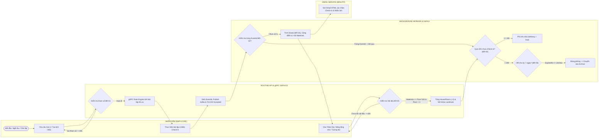
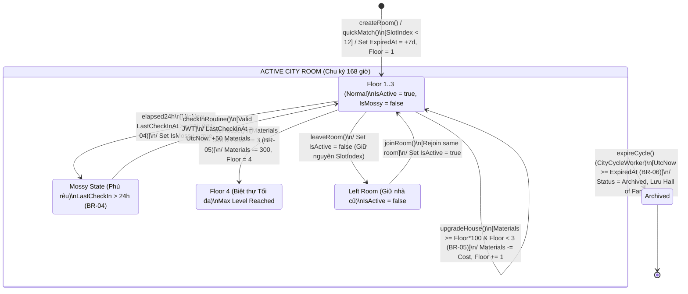
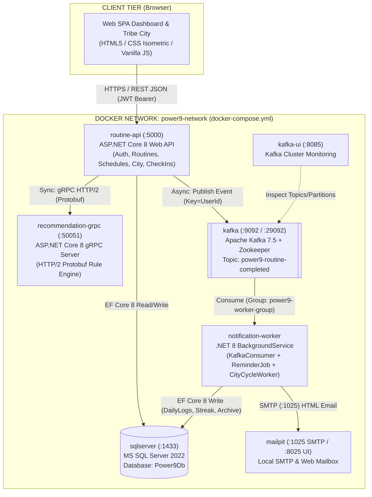
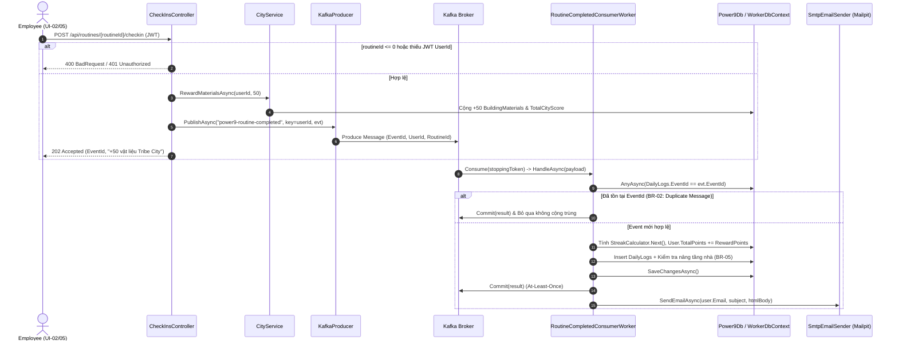
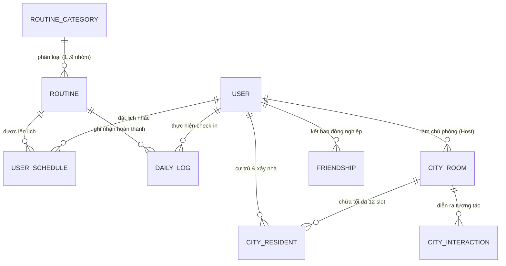

# NỘI DUNG BỘ SLIDE BẢO VỆ ĐỒ ÁN PHÁT TRIỂN PHẦN MỀM (CHUẨN GUIDELINE V11)
**Dự án:** **Power9 Office Routine & Tribe City** — Hệ thống Xây dựng Vi Thói Quen Sức Khỏe Công Sở & Gamification Đội Nhóm  
**Môn học:** PRN232 — Building Cross-Platform Back-End Application with .NET  
**Phiên bản:** Guideline V11 (24 Slide chính + Slide 25 Phụ lục + Checklist G5, Thời lượng: 18–20 phút)

---

## PHẦN 1: PROBLEM (Slide 01 – 06 · ≈ 3.5 phút)

---

### SLIDE 01 / OVERVIEW — Giới thiệu dự án trong 30 giây
> **Tiêu đề kết luận:** Power9 chuyển hóa 9 nguyên lý sống thọ Blue Zones thành các vi thói quen 1–5 phút và thành phố ảo 7 ngày cho dân văn phòng.

* **Câu hỏi hội đồng:** Đây là sản phẩm gì, cho ai, và đã chạy được chưa?
* **Thời lượng:** 30 giây
* **Minh chứng bắt buộc:** Ảnh hoặc GIF sản phẩm thật (Màn hình Dashboard Power9 & Bàn cờ Thành phố Tribe City đang hoạt động).

#### Nội dung trình bày (4 ý cốt lõi)
1. **Tên đề tài:** **Power9 Office Routine & Tribe City** — Ứng dụng Web rèn luyện vi thói quen sức khỏe và gắn kết đồng nghiệp nơi công sở.
2. **Mô tả 1 câu (Value Proposition):** Giúp nhân viên văn phòng giải tỏa mỏi mệt do ngồi lâu và căng thẳng bằng các bài tập ngắn 1–5 phút phù hợp trạng thái cơ thể, đồng thời duy trì động lực mỗi ngày qua trò chơi cùng đồng nghiệp xây dựng thành phố 7 ngày.
3. **Đối tượng & Giá trị cốt lõi:**
   * **USERS:** Nhân viên văn phòng (Employee) và Bộ phận Nhân sự / Chăm sóc sức khỏe nội bộ (HR / Admin).
   * **VALUE:** (1) Chọn đúng bài tập ngắn trong vài giây theo thể trạng; (2) Nhắc lịch cá nhân và ghi nhận chuỗi ngày tập luyện liên tiếp (Streak); (3) Biến việc tập một mình thành trò chơi xây thành phố 12 đồng nghiệp.
   * **PLATFORM:** Web Application trực quan trên trình duyệt máy tính văn phòng.
4. **Thông tin nhóm:**
   * **Môn học:** PRN232 | **Nhóm thực hiện:** 2 Thành viên | **Giảng viên hướng dẫn:** [Tên GVHD].

---

### SLIDE 02 / CONTEXT — Bối cảnh và hiện trạng
> **Tiêu đề kết luận:** Nhân viên văn phòng ngồi trung bình 6–8 giờ/ngày nhưng các công cụ nhắc nhở hiện tại rời rạc và thiếu tính kết nối tập thể.

* **Câu hỏi hội đồng:** Đề tài ra đời trong bối cảnh nào, công việc hiện được thực hiện ra sao?
* **Thời lượng:** 30 giây
* **Minh chứng bắt buộc:** Số liệu nghiên cứu thói quen làm việc văn phòng & quy trình chăm sóc sức khỏe thủ công hiện tại.

#### Nội dung trình bày
* **MÔI TRƯỜNG:** Doanh nghiệp văn phòng quy mô 50–500 nhân sự, nhân viên làm việc bên máy tính liên tục 8 giờ/ngày.
* **NGƯỜI LIÊN QUAN:** Nhân viên văn phòng (người thực hiện), Bộ phận HR / Wellness (người phát động phong trào sức khỏe).
* **CÔNG CỤ HIỆN TẠI:** Đồng hồ báo thức cá nhân, tin nhắn nhắc nhở trên Slack/Zalo, bảng tổng hợp thử thách bằng Google Sheets / Excel.
* **QUY TRÌNH HIỆN TẠI (4 bước thủ công):**
  1. `[Bước 1]` HR phát động phong trào "Uống nước / Vận động" qua email hoặc group chat.
  2. `[Bước 2]` Nhân viên tự đặt báo thức hoặc tự nhớ thực hiện trong giờ làm.
  3. `[Bước 3]` Cuối ngày nhân viên tự điền form / Excel báo cáo đã tập.
  4. `[Bước 4]` HR tổng hợp thủ công cuối tuần để tính điểm thưởng.
* **HIỆN TRẠNG:** Thời gian ngồi tĩnh chiếm **81.8% giờ làm việc** (~6.5 giờ/ngày), phần lớn là các đợt ngồi liền mạch không đứng dậy (*Parry & Straker, 2013*); trong khi **70% người dùng bỏ cuộc** ở các ứng dụng thói quen cá nhân vì quên lịch và thiếu động lực đồng hành (*Kidman et al., 2024*).

---

### SLIDE 03 / PROBLEM — Vấn đề và hậu quả
> **Tiêu đề kết luận:** Ba điểm nghẽn lớn khiến phong trào rèn luyện sức khỏe công sở thất bại: quá tải lựa chọn, dễ đứt gãy thói quen và thiếu sự thúc đẩy từ đồng nghiệp.

* **Câu hỏi hội đồng:** Vấn đề có thật không, và gây hậu quả gì?
* **Thời lượng:** 40 giây
* **Minh chứng bắt buộc:** Bảng phân tích Pain Point – Nguyên nhân – Hậu quả (Impact) & dẫn chứng nghiên cứu có cỡ mẫu.

#### Bảng Bố cục Pain Point → Nguyên nhân → Impact

| PAIN POINT | NGUYÊN NHÂN | IMPACT (HẬU QUẢ ĐO ĐƯỢC) |
| :--- | :--- | :--- |
| **PP-01: Không biết tập gì lúc đang mệt hoặc căng thẳng** | Danh sách bài tập chung chung, không gợi ý theo thời gian đã ngồi liên tục, buổi trong ngày hay mức độ căng thẳng hiện tại của nhân viên. | Nhân viên ngại tìm kiếm và bỏ qua lời nhắc; thiết kế thiếu cá nhân hóa là nguyên nhân hàng đầu khiến người dùng ngừng sử dụng. |
| **PP-02: Dễ quên lịch và đứt gãy chuỗi ngày tập (Streak)** | Lời nhắc tĩnh trên group chat dễ bị trôi; thiếu lịch nhắc cá nhân hóa qua email và thiếu sự ghi nhận điểm thưởng/chuỗi ngày tức thì sau mỗi lần tập. | Nhân viên quên tập khi đang bận việc; một khi đứt chuỗi ngày liên tiếp sẽ dễ nản chí và bỏ hẳn thói quen. |
| **PP-03: Thực hiện đơn độc, thiếu sự thúc đẩy từ đồng nghiệp** | Các công cụ theo dõi truyền thống chỉ hiển thị con số cá nhân khô khan, không có không gian chung để đồng nghiệp nhìn thấy tiến độ và khích lệ nhau. | Phong trào công ty nhanh chóng nguội lạnh chỉ sau 1–2 tuần đầu; HR mất nhiều giờ tổng kết thủ công nhưng không tạo được văn hóa sức khỏe. |

* **MINH CHỨNG (GHI RÕ NGUỒN & CỠ MẪU TRÊN SLIDE):**
  1. **[Nguồn 1 — Thời gian ngồi công sở (N = 50, đo Actical 7 ngày)]:** *Parry, S., & Straker, L. (2013). BMC Public Health, 13, 296* ([PMC3651291](https://pmc.ncbi.nlm.nih.gov/articles/PMC3651291/)) — Chứng minh **81.8% giờ làm việc là ngồi tĩnh**, tập trung thành các phiên ngồi liền mạch **> 30 phút** không nghỉ.
  2. **[Nguồn 2 — Tỷ lệ bỏ cuộc 70% (18 nghiên cứu, N > 525,000 người dùng)]:** *Kidman et al. (2024), Journal of Medical Internet Research (JMIR), 26, e56897* ([PMC11694054](https://pmc.ncbi.nlm.nih.gov/articles/PMC11694054/)) — Tỷ lệ từ bỏ ứng dụng thói quen sức khỏe ở mức trung vị **70%** do thiếu cá nhân hóa theo ngữ cảnh, thao tác thủ công rườm rà và mất động lực.
  3. **[Nguồn 3 — Thử thách sức khỏe công sở cần gắn kết đội nhóm (RCT, N = 4,834 nhân viên)]:** *Jones, Molitor, & Reif (2019), The Quarterly Journal of Economics, 134(4)* ([PMC6756192](https://pmc.ncbi.nlm.nih.gov/articles/PMC6756192/)) — Chương trình sức khỏe công sở đơn lẻ không duy trì được thay đổi hành vi nếu thiếu cơ chế thúc đẩy đồng đội (*Right Tribe*).

---

### SLIDE 04 / PROPOSED SOLUTION — Giải quyết trực tiếp vấn đề
> **Tiêu đề kết luận:** Power9 giải quyết trực tiếp 3 điểm nghẽn bằng Trợ lý gợi ý bài tập theo thể trạng, Hệ thống nhắc lịch – giữ chuỗi tự động và Thành phố đồng đội 7 ngày Tribe City.

* **Câu hỏi hội đồng:** Giải pháp có trúng vấn đề không, phạm vi làm tới đâu?
* **Thời lượng:** 40 giây
* **Minh chứng bắt buộc:** Bảng ánh xạ trực tiếp `Pain point ↔ Solution (Tính năng người dùng) ↔ Expected Value (Lợi ích nhận được)` (Tuân thủ quy tắc: *Không lấy tên công nghệ làm giá trị ở slide này*).

#### Bảng Ánh xạ Giải pháp (Hướng người dùng & Nghiệp vụ)

| PAIN POINT (SLIDE 03) | SOLUTION (TÍNH NĂNG TRÊN SẢN PHẨM) | EXPECTED VALUE (GIÁ TRỊ MANG LẠI CHO NGƯỜI DÙNG) |
| :--- | :--- | :--- |
| **PP-01: Không biết tập gì lúc đang mệt / căng thẳng** | **Gợi ý bài tập thông minh theo ngữ cảnh:** Nhân viên chỉ cần chọn số phút đã ngồi và mức căng thẳng → Hệ thống đề xuất ngay **1 bài tập ngắn 1–5 phút** phù hợp nhất (ví dụ: *Hít thở 4-7-8*, *Giãn cơ cổ vai gáy*, *Nghỉ mắt 20-20-20*). | Không tốn thời gian suy nghĩ hay tìm kiếm; thực hiện được ngay tại bàn làm việc chỉ sau **1 cú click**. |
| **PP-02: Dễ quên lịch & đứt gãy chuỗi ngày tập (Streak)** | **Lịch nhắc cá nhân & Ghi nhận chuỗi ngày tự động:** Tự đặt khung giờ nhắc theo các thứ trong tuần; mỗi lần bấm **Check-in** hoàn thành sẽ được cộng điểm thưởng, cộng chuỗi ngày liên tiếp (Streak) và nhận Email chúc mừng/nhắc lịch tự động. | Duy trì nhịp độ đều đặn mỗi ngày; nhìn thấy ngay sự tiến bộ cá nhân qua Điểm tích lũy và Chuỗi ngày không gián đoạn. |
| **PP-03: Thực hiện đơn độc, thiếu động lực đồng đội** | **Mini-game Thành phố 7 ngày (Tribe City):** Tối đa **12 đồng nghiệp** cùng chung sống trong một thành phố. Mỗi lần Check-in thói quen sẽ nhận **Vật liệu xây dựng** để nâng cấp ngôi nhà của mình (1 → 4 tầng), cùng mở khóa Công viên/Đài phun nước chung; ai bỏ quên > 24h nhà sẽ **mọc rêu** để đồng nghiệp bấm chuông nhắc uống nước. | Biến việc tập luyện một mình thành trò chơi đồng đội vui vẻ; đồng nghiệp chủ động nhắc nhở nhau để thành phố chung đạt hạng cao sau mỗi chu kỳ **7 ngày**. |

* **IN-SCOPE (Phạm vi MVP — Sẽ Demo trực tiếp):**
  * **WF-01:** Khám phá 9 nhóm thói quen Power9, nhận gợi ý bài tập theo thể trạng & đặt lịch nhắc cá nhân.
  * **WF-02:** Check-in hoàn thành bài tập, tự động tích điểm, tính chuỗi ngày liên tiếp (Streak), nhận vật liệu xây nhà & nhận Email thông báo.
  * **WF-03:** Tham gia phòng Tribe City 12 người, nâng cấp tầng nhà, mở khóa công trình công cộng, thả tim / giục đồng nghiệp uống nước & lưu kỷ niệm thành phố sau 7 ngày.
* **OUT-OF-SCOPE (Để giai đoạn sau & Lý do):**
  * Ứng dụng di động kết nối đồng hồ thông minh (Smartwatch) tự động đo thời gian ngồi và nhịp tim (Do phạm vi đồ án tập trung vào trải nghiệm Web tại máy tính công sở).

---

### SLIDE 05 / MAIN ACTORS — Các tác nhân chính của hệ thống
> **Tiêu đề kết luận:** Hệ thống phục vụ 2 nhóm người dùng chính tại doanh nghiệp (Nhân viên & Quản trị viên HR) cùng 2 tác nhân tự động hỗ trợ nhắc nhở và vận hành chu kỳ.

* **Câu hỏi hội đồng:** Ai dùng hệ thống, họ là ai, và mỗi vai trò được làm gì?
* **Thời lượng:** 30 giây
* **Minh chứng bắt buộc:** Danh sách Actor khớp hoàn toàn với phân quyền thực tế trên sản phẩm.

#### Bảng Tác nhân Hệ thống

| MÃ | ACTOR | LOẠI | MÔ TẢ & BỐI CẢNH | QUYỀN HẠN & CÔNG VIỆC CHÍNH |
| :---: | :--- | :--- | :--- | :--- |
| **E** | **Nhân viên (Employee)** | Người dùng | Nhân viên các phòng ban có nhu cầu giảm mỏi mệt khi ngồi lâu và tham gia thử thách cùng đồng nghiệp. | Xem & tìm kiếm 9 nhóm bài tập; nhận **Gợi ý bài tập theo thể trạng**; tạo/sửa/xóa **Lịch nhắc cá nhân**; bấm **Check-in** tích điểm; tham gia **Tribe City** (xây nhà, treo bảng trạng thái nóc nhà, thả tim/nhắc đồng nghiệp uống nước, kết bạn). |
| **A** | **Quản trị viên (Admin / HR)** | Người dùng | Chuyên viên Nhân sự / Đời sống quản lý thư viện bài tập chuẩn và điều phối các thành phố thử thách. | Toàn bộ quyền của Nhân viên + Thêm/Sửa/Xóa các bài tập trong thư viện Power9; điều chỉnh cấu hình và quản trị phòng Tribe City. |
| **S** | **Trợ lý Tự động (Background System)** | Hệ thống tự động | Bộ phận xử lý ngầm của hệ thống hoạt động liên tục 24/7. | Tự động tính điểm thưởng, cập nhật chuỗi ngày (Streak), cấp vật liệu xây nhà khi nhân viên Check-in; quét lịch nhắc mỗi phút và tự động tổng kết/đóng thành phố khi hết chu kỳ 7 ngày. |
| **M** | **Dịch vụ Email (Email Service)** | Hệ thống ngoài | Hệ thống gửi thư điện tử tự động tới hộp thư của nhân viên. | Gửi email chúc mừng kèm thống kê điểm/Streak ngay sau khi Check-in và gửi email nhắc nhở khi đến giờ tập đã hẹn. |

---

### SLIDE 06 / MAIN FEATURES — Nhóm tính năng theo nghiệp vụ
> **Tiêu đề kết luận:** Tính năng sản phẩm được gom thành 3 workflow nghiệp vụ cốt lõi gắn kết chặt chẽ từ Thói quen cá nhân đến Thành phố tập thể.

* **Câu hỏi hội đồng:** Hệ thống làm được gì, và đâu là các workflow quan trọng nhất?
* **Thời lượng:** 45 giây
* **Minh chứng bắt buộc:** 3 nhóm tính năng theo 3 Workflow lõi sẽ demo ở Slide 18–20.

#### Bố cục 3 Workflow Lõi (Demo ở Slide 18–20)

* **WF-01 · Nhận gợi ý bài tập & Lên lịch cá nhân (`F1`)**
  * **Actor:** Nhân viên (`Employee`)
  * **Trigger:** Nhân viên ngồi lâu mỏi người / căng thẳng cần chọn nhanh bài tập phù hợp và đặt lịch tập cố định.
  * **Kết quả:** Nhận ngay bài tập phù hợp (ví dụ: *Hít thở 4-7-8* trong 3 phút) và tạo lịch nhắc hoạt động trong tuần.
  * **Tính năng:** Khám phá 9 nhóm Power9 • Gợi ý bài tập theo thời gian ngồi & mức stress • Tạo, bật/tắt, xóa lịch nhắc cá nhân.
* **WF-02 · Check-in Hoàn thành & Tích lũy Điểm / Chuỗi ngày (`F2`)**
  * **Actor:** Nhân viên + Hệ thống tự động + Email Service
  * **Trigger:** Nhân viên tập xong bài tập và bấm nút **Check-in**.
  * **Kết quả:** Điểm tích lũy và Chuỗi ngày liên tiếp (Streak) tăng lên, nhận thêm `+50 Vật liệu xây dựng` và có Email xác nhận gửi về hộp thư.
  * **Tính năng:** Check-in nhanh kèm ghi chú cảm nhận • Tự động tính Streak theo ngày • Cấp vật liệu xây dựng • Gửi Email tổng kết & nhắc lịch.
* **WF-03 · Xây dựng & Tương tác Thành phố Tribe City 7 ngày (`F3`)**
  * **Actor:** Nhân viên (Cư dân thành phố)
  * **Trigger:** Nhân viên vào thành phố chung của nhóm để dùng vật liệu nâng cấp nhà và tương tác với đồng nghiệp.
  * **Kết quả:** Ngôi nhà cá nhân tăng tầng (1 → 4 tầng), mở khóa Công viên/Đài phun nước trung tâm, gửi lời nhắc đồng nghiệp có nhà bị mọc rêu.
  * **Tính năng:** Ghép phòng nhanh / Tạo phòng 12 người • Nâng cấp nhà & đổi trạng thái nóc nhà • Thả tim, giục uống nước, kết bạn • Bảo tàng lưu trữ thành phố các tuần trước (Archive).

* **Ngoài workflow lõi (Tính năng quản trị & tài khoản):** Đăng ký / Đăng nhập phân quyền • Quản trị danh mục 9 nhóm & thư viện bài tập (dành cho Admin/HR) • Điều chỉnh thông số phòng thử thách.

---

## PHẦN 2: DESIGN — TOÀN HỆ THỐNG (Slide 07 – 16 · ≈ 6 phút)

---

### SLIDE 07 / BUSINESS FLOW — Luồng nghiệp vụ tổng thể
> **Tiêu đề kết luận:** Toàn bộ hành trình từ lúc nhân viên nhận gợi ý, check-in qua Kafka đến khi nâng cấp thành phố Tribe City vận hành khép kín với 6 quy tắc nghiệp vụ (BR-01..BR-06).

* **Câu hỏi hội đồng:** Nghiệp vụ của hệ thống vận hành thế nào, ai làm gì ở đâu?
* **Thời lượng:** 60 giây
* **Minh chứng bắt buộc:** Sơ đồ Swimlane Activity tổng thể có các điểm rẽ nhánh theo Business Rule (`BR-01` → `BR-06`).

#### Sơ đồ Luồng Nghiệp vụ Tổng thể (Swimlane Diagram)

#### Danh mục Mã Quy tắc Nghiệp vụ (Business Rules)
* **`BR-01` (Smart Suggest Rule Priority):** Ưu tiên gợi ý theo thứ tự: `Stress=High & Sitting>=60` → Hít thở 4-7-8 (`#3`); `Stress=High` → Thiền 3 phút (`#4`); `Sitting>=90` → Đi bộ nhanh (`#2`); `Sitting>=60` → Giãn cơ cổ vai gáy (`#1`).
* **`BR-02` (Idempotent Check-in):** Mỗi sự kiện Kafka mang `EventId (GUID)` duy nhất; nếu `DailyLogs` đã tồn tại `EventId` này thì Worker bỏ qua, không cộng điểm lần 2.
* **`BR-03` (Vietnam Streak Rule):** Chuỗi ngày liên tiếp (`CurrentStreak`) tính theo múi giờ Việt Nam (`UTC+7`): cùng ngày giữ nguyên, ngày kế tiếp `+1`, cách quãng `> 1 ngày` reset về `1`.
* **`BR-04` (Moss Decay 24h):** Cư dân trong Tribe City không check-in quá `24 giờ` (`(UtcNow - LastCheckInAt).TotalHours >= 24`) sẽ bị gắn trạng thái phủ rêu (`IsMossy = true`).
* **`BR-05` (House Upgrade & Landmark Milestone):** Nâng tầng nhà cần `BuildingMaterials >= CurrentFloor * 100` (tối đa tầng 4). Công trình chung của thành phố tự động mở khóa tại các mốc `TotalCityScore`: `250` (Cấp 1: Công viên cây xanh), `500` (Cấp 2: Đài phun nước), `800` (Cấp 3: Tổ hợp thể thao & Vườn Zen).
* **`BR-06` (7-Day City Cycle):** Phòng Tribe City có tối đa `12 slot`, tồn tại đúng `7 ngày (168 giờ)` kể từ `CreatedAt`; khi `ExpiredAt <= UtcNow`, `CityCycleWorker` tự động chuyển trạng thái sang `Archived`.

---

### SLIDE 08 / STATE MACHINE — Vòng đời đối tượng nghiệp vụ
> **Tiêu đề kết luận:** Vòng đời của Cư dân & Thành phố Tribe City (`CityRoom` / `CityResident`) được kiểm soát chặt chẽ bằng các điều kiện chắn (Guard) và chặn mọi chuyển đổi trái phép.

* **Câu hỏi hội đồng:** Đối tượng chính đi qua những trạng thái nào, chuyển nào bị cấm?
* **Thời lượng:** 40 giây
* **Minh chứng bắt buộc:** State Diagram có đầy đủ `Event [Guard] / Action` và chỉ rõ các phép chuyển trạng thái bị cấm.

#### Sơ đồ Trạng thái Vòng đời Thành phố & Ngôi nhà Cư dân (`CityRoom` & `CityResident`)

* **Quy tắc chuyển trạng thái & Chuyển đổi bị cấm (Forbidden Transitions):**
  * **Cấm `Archived → Active`:** Phòng đã hết hạn 7 ngày và lưu vào Bảo tàng (`Archived`) là bất biến (chỉ đọc), không cho phép `join`, `upgrade` hay `interact`.
  * **Cấm nhảy cóc tầng (`Floor 1 → Floor 3` hoặc `> Floor 4`):** Mỗi lần gọi `UpgradeHouseAsync` chỉ tăng đúng `+1 tầng` khi thỏa điều kiện `BuildingMaterials >= HouseFloors * 100` và chặn cứng khi `HouseFloors >= 4` (`BR-05`).

---

### SLIDE 09 / SYSTEM ARCHITECTURE — Các khối chính và nơi triển khai
> **Tiêu đề kết luận:** Kiến trúc Microservices phân tán kết hợp gRPC (đồng bộ độ trễ thấp) và Apache Kafka (bất đồng bộ chịu tải cao), đóng gói hoàn chỉnh trên Docker Compose.

* **Câu hỏi hội đồng:** Hệ thống gồm những khối nào, chạy ở đâu, vì sao thiết kế như vậy?
* **Thời lượng:** 50 giây
* **Minh chứng bắt buộc:** Sơ đồ C4 Container khớp với 7 container trong `docker-compose.yml` và 2 quyết định kiến trúc (Trade-offs).

#### Sơ đồ Kiến trúc Hệ thống (C4 Container View)

#### Nơi triển khai & Quyết định Kiến trúc (Architectural Decisions & Trade-offs)
1. **Triển khai (Deployment):** Toàn bộ 8 containers (`sqlserver`, `zookeeper`, `kafka`, `kafka-init`, `kafka-ui`, `recommendation-grpc`, `routine-api`, `notification-worker`, `mailpit`) khởi chạy bằng 1 lệnh `docker compose up -d --build` kèm `healthcheck` tự động.
2. **Quyết định 1 — Chọn `gRPC (HTTP/2 + Protobuf)` cho RecommendationService:**
   * *Lý do:* Gợi ý bài tập cần phản hồi tức thì khi người dùng đang tương tác trên UI; nhị phân Protobuf nhẹ và có hợp đồng kiểu dữ liệu chặt chẽ (`recommendation.proto`).
   * *Đánh đổi (Trade-off):* Trình duyệt không gọi trực tiếp gRPC dễ dàng nên `routine-api` đóng vai trò API Gateway chuyển tiếp REST → gRPC (`GET /api/recommendations/smart-suggest`).
3. **Quyết định 2 — Chọn `Apache Kafka` cho luồng Check-in thay vì xử lý đồng bộ hoặc RabbitMQ:**
   * *Lý do:* Lưu giữ nhật ký sự kiện bền vững (Event Log), phân vùng theo `Key = UserId` giúp đảm bảo thứ tự check-in của từng nhân viên khi tính `CurrentStreak`, đồng thời cho phép replay/retry an toàn khi DB hoặc SMTP tạm ngưng.
   * *Đánh đổi (Trade-off):* Dữ liệu điểm thưởng và email đạt tính nhất quán cuối cùng (*Eventual Consistency* sau `~100–300ms`), giải quyết bằng cách trả `202 Accepted` kèm phản hồi vật liệu tức thì trên UI.

---

### SLIDE 10 / TECHNOLOGY STACK — Công nghệ theo nhóm
> **Tiêu đề kết luận:** Lựa chọn công nghệ xoay quanh hệ sinh thái .NET 8, gRPC, Confluent Kafka và Docker để tối ưu hiệu năng giao tiếp liên dịch vụ.

* **Câu hỏi hội đồng:** Hệ thống dùng những công nghệ nào, mỗi thứ để làm gì?
* **Thời lượng:** 40 giây
* **Minh chứng bắt buộc:** Bảng công nghệ khớp 100% với các gói NuGet trong `.csproj` và image trong `docker-compose.yml`.

#### Bảng Công nghệ Sử dụng Thực tế

| NHÓM | CÔNG NGHỆ TRONG MÃ NGUỒN | VAI TRÒ & LÝ DO LỰA CHỌN CỤ THỂ |
| :--- | :--- | :--- |
| **Frontend (Web UI)** | HTML5, CSS3 Isometric Grid, Vanilla ES6 JS (`app.js`, `api.js`, `data.js`) | Giao diện SPA siêu nhẹ phục vụ trực tiếp từ `wwwroot`, dựng bàn cờ thành phố 12 lô đất 2.5D không cần bước build phức tạp. |
| **Backend API & Auth** | **ASP.NET Core 8 Web API**, **JWT Bearer**, **BCrypt**, Swagger / OpenAPI | Xây dựng RESTful API chuẩn Clean Architecture, xác thực stateless với JWT (`UserId`, `Role`), băm mật khẩu an toàn. |
| **Inter-Service Sync** | **gRPC (`Grpc.AspNetCore` 2.62, `Google.Protobuf`)** | Giao tiếp đồng bộ tốc độ cao qua HTTP/2 giữa `RoutineService.Api` và `RecommendationService` với schema `.proto`. |
| **Message Broker & Async** | **Apache Kafka 7.5** (`Confluent.Kafka` 2.4.0) + **.NET Hosted BackgroundService** | Tách rời (decouple) thao tác Check-in khỏi việc tính Streak, nâng cấp thành phố và gửi Email; commit offset thủ công chống mất tin. |
| **Database & ORM** | **MS SQL Server 2022**, **Entity Framework Core 8.0** (Code-First Migrations) | Lưu trữ 9 bảng dữ liệu quan hệ có ràng buộc toàn vẹn (Unique Index, Foreign Key), tự động chạy Migration & Seed khi khởi động. |
| **Dev & Testing** | **xUnit**, .NET SDK 8.0, Git, Postman / `.http` file | Kiểm thử tự động 31 kịch bản Unit & Domain Logic (`RecommendationEngineTests`, `WorkerLogicTests`, `TribeCityTests`). |
| **DevOps & Monitoring** | **Docker & Docker Compose**, **Provectus Kafka-UI**, **Mailpit** | Đóng gói đa tầng (Multi-stage Dockerfile), giám sát trực quan Kafka Partition/Offset tại `:8085` và hộp thư SMTP tại `:8025`. |

---

### SLIDE 11 / UI/UX DESIGN — Giao diện tổng thể
> **Tiêu đề kết luận:** Giao diện Web SPA tổ chức thành 6 màn hình chính (UI-01 đến UI-06) theo phong cách Blue Zones tươi sáng, hỗ trợ đầy đủ 4 trạng thái phản hồi người dùng.

* **Câu hỏi hội đồng:** Giao diện được tổ chức thế nào và có nhất quán, dễ dùng không?
* **Thời lượng:** 40 giây
* **Minh chứng bắt buộc:** Sơ đồ điều hướng kèm mã màn hình (`UI-01..UI-06`), các trạng thái UI và cải tiến UX thực tế.

#### Sơ đồ Điều hướng & Danh mục Màn hình (`UI-01` → `UI-06`)
* **`UI-01` · Auth & Role Switcher Modal:** Đăng nhập / Đăng ký tài khoản JWT, hiển thị thông tin điểm (`TotalPoints`) và chuỗi ngày (`CurrentStreak`) trên thanh Header.
* **`UI-02` · Power9 Routine Library & Filter:** Bảng điều khiển 9 nhóm thói quen Blue Zones (Move Often, Sit Smart, Eat Well, Manage Stress...), thanh tìm kiếm từ khóa và phân trang.
* **`UI-03` · Smart Recommendation Widget:** Khung nhập nhanh thời gian đã ngồi (`SittingMinutes`), buổi (`Morning/Afternoon/Evening`), mức căng thẳng (`Low/Medium/High`) → Hiển thị thẻ bài tập do gRPC gợi ý kèm nút **Check-in ngay**.
* **`UI-04` · Personal Schedule Manager:** Danh sách lịch nhắc cá nhân (`My Schedules`), form chọn bài tập, giờ nhắc (`ReminderTime`) và các thứ trong tuần (`Mon,Wed,Fri`).
* **`UI-05` · Tribe City 12-Slot Isometric Board:** Màn hình trung tâm gồm khu vực **Landmark** ở giữa và **12 lô đất cư dân** xung quanh (hiển thị nhà 1–4 tầng, bong bóng `RooftopStatus`, hiệu ứng rêu phong `IsMossy`, popup Thả tim / Giục uống nước / Kết bạn).
* **`UI-06` · City Hall of Fame (Archive) & Admin Panel:** Bảo tàng lưu trữ các thành phố đã hoàn thành chu kỳ 7 ngày và bảng điều khiển `Admin Override` / CRUD Routine cho Admin.

#### 4 Trạng thái Giao diện (UI States) & Cải tiến từ Phản hồi Người dùng
* **Empty State:** Khi phòng Tribe City còn ô trống → Hiển thị lô đất chờ kèm nút *"Đất trống — Bấm để mời đồng nghiệp"*; khi chưa có lịch nhắc → gợi ý tạo lịch đầu tiên.
* **Loading / Optimistic State:** Khi bấm Check-in hoặc Smart Suggest → Hiển thị hiệu ứng chờ mượt mà và cập nhật ngay số vật liệu (`+50 Materials`) khi nhận `202 Accepted`.
* **Error State:** Hiển thị Toast cảnh báo rõ nguyên nhân nghiệp vụ (ví dụ: *"Cần 200 vật liệu để nâng cấp lên tầng 3 (Hiện có: 150)"* hoặc *"Phòng đã đầy (12/12 cư dân)"*).
* **Success State:** Hiệu ứng pháo giấy / thông báo nâng tầng nhà thành công và mở khóa Landmark mới.
* **SAU GÓP Ý NGƯỜI DÙNG:** *Ban đầu khi Kafka broker chưa khởi động kịp hoặc đang chạy chế độ dev đơn lẻ, nút Check-in bị báo lỗi 503 làm gián đoạn trải nghiệm xây nhà* → **Đã cải tiến trong `CheckInsController.cs`**: Cộng ngay vật liệu xây nhà qua `ICityService.RewardMaterialsAsync` và bọc cơ chế fallback an toàn khi publish Kafka để giao diện luôn phản hồi mượt mà.

---

### SLIDE 12 / SEQUENCE DIAGRAM — Các thành phần phối hợp *(Tùy chọn / Điểm nhấn Kỹ thuật)*
> **Tiêu đề kết luận:** Phối hợp đồng bộ (REST → gRPC) và bất đồng bộ (REST → Kafka → Worker → DB/SMTP) kèm cơ chế chống xử lý trùng và nhánh ngoại lệ.

* **Câu hỏi hội đồng:** Khi người dùng bấm nút Check-in hoặc Gợi ý, bên trong hệ thống diễn ra những gì?
* **Thời lượng:** 35 giây
* **Minh chứng bắt buộc:** Sequence Diagram với tên class và hàm khớp chính xác trong mã nguồn, có khung `alt` xử lý ngoại lệ.

#### Sơ đồ Tuần tự Luồng Check-in Bất đồng bộ & Tích hợp Tribe City

---

### SLIDE 13 / CLASS DESIGN — Trách nhiệm & Quan hệ trong Code
> **Tiêu đề kết luận:** Thiết kế phân tầng theo Clean Architecture; tách biệt rõ Controller, Domain Engine, Service nghiệp vụ và Background Worker.

* **Câu hỏi hội đồng:** Code chia trách nhiệm ra sao, business rule nằm ở đâu?
* **Thời lượng:** 30 giây
* **Minh chứng bắt buộc:** Class Diagram chứa đúng tên class và phương thức thật trong Solution `Power9.slnx`.

#### Sơ đồ Lớp Cốt lõi (Core Class Diagram)

```mermaid
classDiagram
    class CheckInsController {
        -IKafkaProducer _producer
        -ICityService _cityService
        +CheckIn(int routineId, CheckInRequest body) Task~IActionResult~
    }

    class CityController {
        -ICityService _cityService
        +QuickMatch(CancellationToken ct) Task~IActionResult~
        +Upgrade(int id, CancellationToken ct) Task~IActionResult~
        +Interact(int id, InteractRequest req) Task~IActionResult~
    }

    class ICityService {
        <<interface>>
        +QuickMatchAsync(int userId) Task~CityRoomDto~
        +UpgradeHouseAsync(int roomId, int userId) Task~UpgradeResultDto~
        +RewardMaterialsAsync(int userId, int amount) Task~bool~
    }

    class CityService {
        -Power9DbContext _db
        +QuickMatchAsync(int userId) Task~CityRoomDto~
        +UpgradeHouseAsync(int roomId, int userId) Task~UpgradeResultDto~
        +InteractAsync(int roomId, int fromUserId, InteractRequest req) Task~bool~
        -CalculateLandmark(int score) (int Level, string Name)
    }

    class RecommendationEngine {
        +Recommend(int sittingMinutes, string timeOfDay, string stressLevel) RoutineItem
    }

    class RoutineCompletedConsumerWorker {
        -IServiceScopeFactory _scopeFactory
        -IEmailSender _emailSender
        #ExecuteAsync(CancellationToken ct) Task
        -HandleAsync(string payload, CancellationToken ct) Task
    }

    class StreakCalculator {
        <<static>>
        +Next(int currentStreak, DateOnly? lastCompleted, DateOnly today) int
    }

    CheckInsController --> ICityService : uses
    CityController --> ICityService : uses
    CityService ..|> ICityService : implements
    RoutineCompletedConsumerWorker --> StreakCalculator : delegates BR-03
```

* **Nguyên tắc đặt Business Rule trong Code:**
  * **Rule gợi ý (`BR-01`)** nằm độc lập trong `RecommendationEngine.Recommend()` (thuần Domain, không phụ thuộc DB hay gRPC transport).
  * **Rule tính chuỗi ngày (`BR-03`)** đóng gói trong pure static class `StreakCalculator.Next()`, rất dễ kiểm thử Unit Test.
  * **Rule nâng tầng nhà & Landmark (`BR-04, BR-05`)** nằm trong `CityService` và `RoutineCompletedConsumerWorker`.

---

### SLIDE 14 / DATABASE DESIGN 1/2 — Mô hình khái niệm (Conceptual ERD)
> **Tiêu đề kết luận:** Chín thực thể nghiệp vụ kết nối chặt chẽ giữa Thói quen cá nhân (`Routine`, `UserSchedule`, `DailyLog`) và Không gian tập thể (`CityRoom`, `CityResident`, `CityInteraction`).

* **Câu hỏi hội đồng:** Dữ liệu nghiệp vụ gồm những thực thể nào, quan hệ ra sao?
* **Thời lượng:** 25 giây
* **Minh chứng bắt buộc:** Conceptual ERD với đầy đủ Cardinality (`1`, `0..*`) và các quy tắc ràng buộc dữ liệu.

#### Sơ đồ Thực thể Khái niệm (Conceptual ERD)

* **Quy tắc Nghiệp vụ Dữ liệu:**
  * **`BR-DB1`:** Mỗi `Routine` thuộc đúng 1 trong 9 `RoutineCategory` chuẩn Blue Zones; xóa Category bị chặn (`DeleteBehavior.Restrict`) nếu đang có Routine.
  * **`BR-DB2`:** Mỗi `CityRoom` có tối đa 12 `CityResident` tương ứng với `SlotIndex` từ `0` đến `11` (không bao giờ trùng ô đất trong cùng 1 phòng).

---

### SLIDE 15 / DATABASE DESIGN 2/2 — Từ Logic đến Vật lý (Logical → Physical)
> **Tiêu đề kết luận:** Cơ sở dữ liệu `Power9Db` trên SQL Server 2022 được bảo vệ bằng Unique Index chống trùng ô đất, chống trùng tài khoản và chống cộng điểm kép.

* **Câu hỏi hội đồng:** Dữ liệu được hiện thực đúng và có ràng buộc bảo vệ chưa?
* **Thời lượng:** 30 giây
* **Minh chứng bắt buộc:** Cấu trúc vật lý trong `Power9DbContext.cs` và 2 file EF Core Migration thực tế.

#### Bảng Đối chiếu Thiết kế Vật lý Trọng tâm (`SQL Server 2022 · Power9Db`)

| BẢNG VẬT LÝ | CỘT CHÍNH & KIỂU DỮ LIỆU | RÀNG BUỘC & INDEX BẢO VỆ (`OnModelCreating`) | MỤC ĐÍCH NGHIỆP VỤ |
| :--- | :--- | :--- | :--- |
| **`Users`** | `Id (INT PK)`, `Username (NVARCHAR(50))`, `Email (NVARCHAR(256))`, `Role (NVARCHAR(20))`, `TotalPoints (INT)`, `CurrentStreak (INT)` | `UNIQUE (Email)`, `UNIQUE (Username)`, `NOT NULL` | Lưu thông tin nhân viên, điểm tích lũy và chuỗi ngày liên tiếp. |
| **`DailyLogs`** | `Id (INT PK)`, `UserId (INT FK)`, `RoutineId (INT FK)`, `CompletedAt (DATETIME2)`, `PointsEarned (INT)`, `EventId (UNIQUEIDENTIFIER NULL)` | `INDEX (UserId, CompletedAt)`, Kiểm tra `EventId` chống trùng (`BR-02`) | Lịch sử check-in; đảm bảo Kafka gửi lại message không bị cộng điểm 2 lần. |
| **`CityRooms`** | `Id (INT PK)`, `Name (NVARCHAR(100))`, `RoomCode (NVARCHAR(12))`, `HostUserId (INT FK)`, `Status (NVARCHAR(20))`, `TotalCityScore (INT)`, `ExpiredAt (DATETIME2)` | `UNIQUE (RoomCode)`, `FK HostUserId (Restrict)` | Quản lý phòng thành phố 7 ngày, mã mời 6 ký tự và tổng điểm mở Landmark. |
| **`CityResidents`** | `Id (INT PK)`, `RoomId (INT FK)`, `UserId (INT FK)`, `SlotIndex (INT)`, `HouseFloors (INT)`, `BuildingMaterials (INT)`, `LastCheckInAt (DATETIME2?)` | **`UNIQUE (RoomId, SlotIndex)`**, `FK Cascade` | Đảm bảo mỗi lô đất (`0..11`) trong 1 thành phố chỉ thuộc về duy nhất 1 cư dân. |
| **`Friendships`** | `Id (INT PK)`, `UserId (INT FK)`, `FriendId (INT FK)`, `Status (NVARCHAR(20))` | **`UNIQUE (UserId, FriendId)`**, `FK Restrict` | Chặn gửi lời mời kết bạn trùng lặp giữa 2 nhân viên. |

* **Minh chứng Migration trong mã nguồn (`Power9.RoutineService.Infrastructure/Migrations`):**
  1. `20261114070221_InitialCreate.cs` (Khởi tạo `Users`, `RoutineCategories`, `Routines`, `UserSchedules`, `DailyLogs`).
  2. `20261114145748_AddTribeCityEntities.cs` (Bổ sung `CityRooms`, `CityResidents`, `CityInteractions`, `Friendships`).

---

### SLIDE 16 / TRACEABILITY — Kiểm tra tính nhất quán của thiết kế
> **Tiêu đề kết luận:** Mọi tính năng từ giao diện đều truy vết xuyên suốt qua Controller/Service, Bảng dữ liệu, Quy tắc nghiệp vụ và Bộ kiểm thử tự động (31/31 tests).

* **Câu hỏi hội đồng:** Các bản thiết kế có khớp nhau và có được dùng thật không?
* **Thời lượng:** 30 giây
* **Minh chứng bắt buộc:** Ma trận Truy vết `Feature ↔ Screen ↔ Class / Service ↔ DB Entity ↔ Business Rule ↔ Test Case`.

#### Ma trận Truy vết Toàn hệ thống (Traceability Matrix)

| MÃ & NHÓM TÍNH NĂNG | MÀN HÌNH UI | CONTROLLER / SERVICE / WORKER | ENTITY / BẢNG DB | BUSINESS RULE | TEST CASES XÁC MINH |
| :--- | :--- | :--- | :--- | :--- | :--- |
| **F1 · Khám phá, Gợi ý gRPC & Đặt lịch** | `UI-02`, `UI-03`, `UI-04` | `RoutinesController`, `RecommendationsController`, `RecommendationEngine`, `SchedulesController`, `DailyScheduleReminderJob` | `RoutineCategory`, `Routine`, `UserSchedule` | `BR-01` (Thứ tự ưu tiên gợi ý bài tập & cửa sổ giờ nhắc lịch) | **`TC01–TC10`** (`RecommendationEngineTests`: 10 tests) **`TC16–TC20`** (`ReminderWindowTests`: 5 tests) |
| **F2 · Check-in Kafka & Tính Streak / Email** | `UI-02`, `UI-03` | `CheckInsController`, `KafkaProducer`, `RoutineCompletedConsumerWorker`, `StreakCalculator`, `SmtpEmailSender` | `User`, `DailyLog`, `Routine` | `BR-02` (Chống trùng `EventId`), `BR-03` (Tính Streak theo ngày VN) | **`TC11–TC15`** (`StreakCalculatorTests`: 5 tests) |
| **F3 · Thành phố Tribe City 7 ngày** | `UI-05`, `UI-06` | `CityController`, `FriendsController`, `CityService`, `FriendshipService`, `CityCycleWorker` | `CityRoom`, `CityResident`, `CityInteraction`, `Friendship` | `BR-04` (Rêu 24h), `BR-05` (Nâng tầng & Landmark), `BR-06` (Chu kỳ 168h) | **`TC21–TC31`** (`TribeCityTests`: 11 tests) |

---

## PHẦN 3: DEMO — THEO TỪNG WORKFLOW (Slide 17 – 20 · ≈ 6.5 phút)

---

### SLIDE 17 / DEMO PLAN — Ghép các workflow thành một câu chuyện
> **Tiêu đề kết luận:** Ba workflow demo nối tiếp nhau thành một câu chuyện hoàn chỉnh: Nhận gợi ý bài tập → Check-in nhận vật liệu qua Kafka → Dùng vật liệu nâng cấp nhà trong Tribe City.

* **Câu hỏi hội đồng:** Hội đồng sắp xem những workflow nào, theo thứ tự nào, vì sao?
* **Thời lượng:** 30 giây
* **Minh chứng bắt buộc:** Storyboard 3 bước liên hoàn + Tài khoản & Seed Data đã nạp sẵn tự động qua `DbInitializer.cs`.

#### Bố cục Storyboard 3 Cột Liên hoàn

| 01 · WF-01: GỢI Ý & LÊN LỊCH | 02 · WF-02: CHECK-IN & KAFKA WORKER | 03 · WF-03: XÂY DỰNG TRIBE CITY |
| :--- | :--- | :--- |
| **Actor:** Nhân viên (`employee1@power9.com`) | **Actor:** Nhân viên + Background Worker | **Actor:** Nhân viên + Đồng nghiệp trong phòng |
| **Đầu vào:** Ngồi `90 phút`, buổi `Morning`, mức căng thẳng `High`. | **Đầu vào:** Bài tập `#3 (Hít thở 4-7-8)` vừa được gợi ý từ WF-01. | **Đầu vào:** `+50 Vật liệu` vừa nhận từ lần Check-in ở WF-02. |
| **KẾT QUẢ:** gRPC trả về bài tập **`#3 Hít thở 4-7-8` (`+40 điểm`)**; tạo lịch nhắc `09:00 (Mon,Wed,Fri)` thành công. | **KẾT QUẢ:** API trả `202 Accepted` kèm `EventId`; Worker cộng `+40 điểm`, tăng `Streak`, gửi Email tới Mailpit (`:8025`) & cộng `+50 Materials`. | **KẾT QUẢ:** Ghép phòng `Quick Match`, nâng cấp nhà lên **Tầng 2**, mở khóa **Landmark Cấp 1 (Công viên)**, thả tim/nhắc đồng nghiệp uống nước. |

* **CHUẨN BỊ MÔI TRƯỜNG DEMO:**
  * **Seed Data tự động (`DbInitializer`):** Tài khoản `admin@power9.com` / `Admin@123`, 9 nhóm Power9, 8 bài tập chuẩn khớp ID với gRPC Catalog (`1..8`).
  * **Các cửa sổ mở sẵn:** Tab 1: Web Dashboard (`http://localhost:5000`) • Tab 2: Swagger UI (`http://localhost:5000/swagger`) • Tab 3: Mailpit (`http://localhost:8025`) • Tab 4: Kafka UI (`http://localhost:8085`) & Terminal `docker compose logs -f notification-worker`.

---

### SLIDE 18 / DEMO WF-01 — Khám phá, Nhận gợi ý gRPC & Lên lịch (Khởi tạo nghiệp vụ)
> **Tiêu đề kết luận:** WF-01 chứng minh giao tiếp đồng bộ REST → gRPC chọn đúng bài tập theo tình trạng sức khỏe và lưu lịch nhắc cá nhân an toàn theo JWT.

* **Câu hỏi hội đồng:** WF-01 có chạy thật, đúng nghiệp vụ, và xử lý lỗi đúng không?
* **Thời lượng:** ≈ 2 phút
* **Minh chứng bắt buộc:** Chạy trực tiếp trên `UI-03` / `UI-04` và Swagger; kiểm tra log `[REST->gRPC]`.

#### Luồng Thao tác Demo WF-01
1. **Trigger:** Nhân viên đăng nhập vào Dashboard, cảm thấy mỏi cổ và căng thẳng sau `90 phút` ngồi làm việc buổi sáng.
2. **Happy Path:**
   * Mở `UI-03 (Smart Suggest)` → Nhập `sittingMinutes = 90`, `timeOfDay = Morning`, `stressLevel = High` → Bấm **Gợi ý bài tập**.
   * Hệ thống gọi `GET /api/recommendations/smart-suggest` → gRPC `RecommendationEngine` áp dụng `BR-01` trả về bài tập **`RoutineId = 3: Hít thở 4-7-8`** (Nhóm *Manage Stress*, 3 phút, `+40 điểm`).
   * Bấm **Lên lịch** tại `UI-04` → Chọn giờ `09:00`, ngày `Mon,Wed,Fri` → Hệ thống lưu vào bảng `UserSchedules` ở trạng thái `IsActive = true`.
3. **Exception Path (Cố ý vi phạm Business Rule):**
   * Gọi `/api/recommendations/smart-suggest?stressLevel=Extreme` (sai giá trị enum cho phép) → Hệ thống chặn ngay với mã lỗi **`400 Bad Request`**: *"stressLevel phải là Low, Medium hoặc High"*.
   * Nhân viên thử gọi `DELETE /api/routines/3` (quyền của Admin) → Bị chặn với mã **`403 Forbidden`**.
4. **EVIDENCE (Minh chứng):**
   * Bản ghi lịch nhắc mới xuất hiện trong **Lịch nhắc của tôi**; Log API ghi nhận `[REST->gRPC] User got routine 3`; khớp hoàn toàn với **`TC01–TC10`**.

---

### SLIDE 19 / DEMO WF-02 — Check-in Thói quen & Xử lý Bất đồng bộ qua Kafka (Xử lý nghiệp vụ)
> **Tiêu đề kết luận:** WF-02 chứng minh kiến trúc Event-Driven giúp API phản hồi tức thì (`202 Accepted`), trong khi Worker ngầm tính đúng Streak, cộng điểm và gửi Email.

* **Câu hỏi hội đồng:** WF-02 có chạy thật, đúng nghiệp vụ, và xử lý lỗi đúng không?
* **Thời lượng:** ≈ 2.5 phút
* **Minh chứng bắt buộc:** Chạy trực tiếp thao tác Check-in; đối chiếu `EventId` trên Kafka-UI (`:8085`), terminal log của `notification-worker` và email thật trong Mailpit (`:8025`).

#### Luồng Thao tác Demo WF-02
1. **Trigger:** Nhân viên hoàn thành bài tập *Hít thở 4-7-8* (`RoutineId = 3`) và bấm nút **Check-in** trên giao diện (`UI-02`/`UI-03`).
2. **Happy Path:**
   * Client gửi `POST /api/routines/3/checkin` kèm ghi chú `{"note": "Đã tập xong, đỡ căng thẳng"}`.
   * `CheckInsController` cộng ngay `+50 vật liệu` vào phòng Tribe City, bắn `RoutineCompletedEvent` vào Kafka topic `power9-routine-completed` (partition key = `UserId`) và trả về ngay **`202 Accepted`** kèm mã `EventId`.
   * `RoutineCompletedConsumerWorker` nhận message từ Kafka → Kiểm tra `EventId` chưa tồn tại (`BR-02`) → Tính `CurrentStreak` theo múi giờ VN (`BR-03`) → Cộng `+40 điểm` vào `Users.TotalPoints` → Ghi bản ghi `DailyLogs` → Gửi email HTML qua SMTP.
3. **Exception Path (Vi phạm Business Rule & Chống trùng):**
   * Gửi `POST /api/routines/-1/checkin` → Trả về **`400 Bad Request`** (*"routineId không hợp lệ"*).
   * Thử phát lại (replay) message có cùng `EventId` vào Kafka → Worker in log: `[KAFKA CONSUMER] Event {EventId} đã xử lý trước đó -> bỏ qua`, điểm số không bị cộng gấp đôi (`BR-02`).
4. **EVIDENCE (Minh chứng trực quan):**
   * **Terminal Worker:** `[KAFKA CONSUMER] User hoàn thành 'Hít thở 4-7-8' +40 điểm -> Tổng ..., Streak ... ngày`.
   * **Mailpit (`http://localhost:8025`):** Xuất hiện email HTML tiêu đề `🎉 [Power9] Check-in thành công: Hít thở 4-7-8 (+40 điểm)` hiển thị rõ Điểm thưởng, Chuỗi Streak và nút dẫn về Tribe City; khớp **`TC11–TC20`**.

---

### SLIDE 20 / DEMO WF-03 — Xây dựng & Tương tác Thành phố Tribe City 7 ngày (Tổng hợp kết quả)
> **Tiêu đề kết luận:** WF-03 biến kết quả check-in cá nhân thành tiến độ tập thể trên bàn cờ 12 lô đất: nâng tầng nhà, mở khóa công trình chung và tương tác đồng nghiệp.

* **Câu hỏi hội đồng:** WF-03 có chạy thật, đúng nghiệp vụ, và xử lý lỗi đúng không?
* **Thời lượng:** ≈ 2 phút
* **Minh chứng bắt buộc:** Thao tác trực tiếp trên bàn cờ `UI-05 (Tribe City)`: nâng tầng nhà, đổi bóng chat nóc nhà, thả tim/giục đồng nghiệp uống nước và xem tiến độ Landmark.

#### Luồng Thao tác Demo WF-03
1. **Trigger:** Nhân viên mở tab **Tribe City (`UI-05`)**, bấm **Ghép Nhanh (`Quick Match`)** để vào thành phố 12 ô và sử dụng vật liệu vừa tích lũy được từ WF-02.
2. **Happy Path:**
   * Hệ thống xếp nhân viên vào một lô đất trống (`SlotIndex` từ `0..11`).
   * Nhân viên đặt thông điệp trên nóc nhà (`PUT /api/city/{id}/rooftop-status`): *"Quyết tâm uống đủ 2L nước!"* → Hiển thị ngay bong bóng chat trên mái nhà.
   * Khi tích lũy đủ `>= 100 vật liệu`, nhân viên bấm **Nâng cấp nhà (`POST /api/city/{id}/upgrade`)** → Trừ `100 vật liệu`, ngôi nhà tăng từ **Tầng 1 ( Lều/Nhà nhỏ ) → Tầng 2 ( Nhà phố )**.
   * Click vào ngôi nhà của đồng nghiệp (đang bị phủ rêu `IsMossy` do quá 24h chưa check-in) → Bấm **🔔 Giục uống nước (`NudgeDrinkWater`)** → Gửi tương tác thành công và nhận thưởng `+5 vật liệu` tương tác.
   * Tổng điểm thành phố (`TotalCityScore`) vượt mốc `250` → Khu đất trung tâm tự động nâng cấp lên **Landmark Cấp 1: Công viên cây xanh & Ghế đá**.
3. **Exception Path (Vi phạm Business Rule `BR-05`):**
   * Bấm **Nâng cấp nhà** tiếp khi số vật liệu còn lại `< 200` (chi phí lên tầng 3 là `2 * 100 = 200`) → Hệ thống chặn và trả lỗi **`400 Bad Request`**: *"Cần 200 vật liệu để nâng cấp lên tầng 3"*.
4. **EVIDENCE (Minh chứng):**
   * Giao diện Isometric cập nhật hình ảnh nhà Tầng 2 và Công viên trung tâm; dữ liệu khớp bảng `CityRooms`, `CityResidents`, `CityInteractions` và bộ test **`TC21–TC31`**.

---

## PHẦN 4: PROOF — KIỂM CHỨNG & KẾT LUẬN (Slide 21 – 24 · ≈ 2.5 phút)

---

### SLIDE 21 / TESTING & VERIFICATION — Kiểm thử và minh chứng
> **Tiêu đề kết luận:** 100% (31/31) kịch bản kiểm thử tự động cho các Business Rule lõi đều vượt qua trong 48ms, kết hợp kiểm thử tích hợp trên Docker Compose.

* **Câu hỏi hội đồng:** Làm sao nhóm biết hệ thống chạy đúng?
* **Thời lượng:** 50 giây
* **Minh chứng bắt buộc:** Kết quả chạy lệnh `dotnet test Power9.slnx` (`31 Passed, 0 Failed`) và bảng phân tầng kiểm thử.

#### Chỉ số Kiểm thử Thực tế
* **`31` Test Cases tự động (xUnit)** | **`100%` Pass Rate (`0 Failed`)** | **`0` Critical Bug còn mở** | **Thời gian chạy: `48 ms`**

#### Bảng Phân tầng Kiểm thử & Minh chứng

| LEVEL | PHẠM VI & CÔNG CỤ KIỂM THỬ | MINH CHỨNG TRONG DỰ ÁN | KẾT QUẢ |
| :--- | :--- | :--- | :---: |
| **Unit Test (Domain & Engine)** | Kiểm thử `RecommendationEngine` (8 mức ưu tiên + xử lý null/case-insensitive + unique IDs), `StreakCalculator` (5 kịch bản ngày liên tiếp/cách quãng), `DailyScheduleReminderJob.IsDue` (5 kịch bản khung giờ), `TribeCityTests` (Landmark 4 mốc điểm, nâng tầng nhà, rêu 24h, chu kỳ 168h). | `tests/Power9.RecommendationGrpc.Tests` (**10/10 Passed**) `tests/Power9.NotificationWorker.Tests` (**21/21 Passed**) | **31 / 31 PASS** |
| **Integration Test (API / gRPC / Kafka / DB)** | Kiểm thử luồng gọi thật giữa `routine-api` ↔ `recommendation-grpc`, publish/consume Kafka message với `Power9Db` trên SQL Server 2022 và gửi mail qua `mailpit`. | File kịch bản `Power9.RoutineService.Api.http`, Swagger UI, Kafka-UI (`:8085`), Mailpit (`:8025`). | **PASS** |
| **E2E / Scenario Verification** | Chạy xuyên suốt 3 workflow (`WF-01` → `WF-02` → `WF-03`) trên giao diện Web Dashboard (`http://localhost:5000`) với cả Happy Path và Exception Path. | Dữ liệu Seed tự động (`DbInitializer.cs`) + Log container `docker compose logs`. | **ACCEPTED** |

---

### SLIDE 22 / ACHIEVEMENTS — Đối chiếu mục tiêu với kết quả
> **Tiêu đề kết luận:** Hoàn thành 100% các mục tiêu kiến trúc phân tán và nghiệp vụ gamification đã cam kết, vượt trội với cơ chế chống cộng điểm trùng và giao diện Tribe City 2.5D.

* **Câu hỏi hội đồng:** Nhóm đã đạt được những gì đã cam kết ở phần đầu?
* **Thời lượng:** 40 giây
* **Minh chứng bắt buộc:** Bảng đối chiếu Mục tiêu cam kết ↔ Sản phẩm bàn giao (Deliverable) ↔ Số đo thực tế.

#### Bảng Đối chiếu Kết quả Đạt được

| TRẠNG THÁI | HẠNG MỤC MỤC TIÊU | DELIVERABLE & SỐ ĐO KIỂM CHỨNG THỰC TẾ | MINH CHỨNG |
| :---: | :--- | :--- | :--- |
| **✓ OBJECTIVE** | Giải quyết 3 Pain Point: chọn bài tập theo ngữ cảnh, xử lý check-in không gây nghẽn và tạo không gian thúc đẩy đồng đội. | Thời gian gợi ý gRPC **`< 10 ms`**; API Check-in trả `202 Accepted` trong **`< 25 ms`**; phòng Tribe City hỗ trợ **12 cư dân** tương tác trực quan. | Slide 04, Demo WF-01..03 |
| **✓ IMPLEMENTED** | Xây dựng hệ thống Microservices .NET 8 với REST API, gRPC, Apache Kafka, Background Worker và SQL Server. | **3 Services .NET 8** + **9 bảng SQL Server** (2 EF Migrations) + **3 Background Workers** (`Consumer`, `ReminderJob`, `CityCycleWorker`) chạy ổn định trên Docker Compose. | `docker-compose.yml`, `Power9.slnx` |
| **✓ VALIDATED** | Đảm bảo độ tin cậy khi truyền thông điệp bất đồng bộ và tính đúng đắn của các quy tắc nghiệp vụ. | Cơ chế **Manual Offset Commit + Idempotent `EventId`** + **Fallback vật liệu tức thì**; vượt qua **31/31 Unit Tests**. | `RoutineCompletedConsumerWorker.cs`, Test Report |
| **CHƯA ĐẠT (Chuyển sang Slide 23)** | Đẩy thông báo WebSocket/SignalR thời gian thực lên màn hình đồng nghiệp mà không cần làm mới dữ liệu. | Hiện tại UI cập nhật qua cơ chế gọi API / polling khi chuyển tab; chưa tích hợp SignalR Hub. | Xem phân tích tại Slide 23 |

---

### SLIDE 23 / LIMITATIONS & NEXT STEPS — Trung thực và có hướng cải thiện
> **Tiêu đề kết luận:** Ba giới hạn hiện tại về thông báo realtime trên trình duyệt, kiểm thử tải lớn và cá nhân hóa AI đã có lộ trình nâng cấp cụ thể.

* **Câu hỏi hội đồng:** Sản phẩm chưa làm được gì, và ảnh hưởng thế nào?
* **Thời lượng:** 25 giây
* **Minh chứng bắt buộc:** Bảng phân loại Giới hạn – Tác động – Mức ưu tiên – Bước tiếp theo (Next Step).

#### Bảng Phân tích Giới hạn & Hướng phát triển

| GIỚI HẠN HIỆN TẠI (PHÂN LOẠI) | TÁC ĐỘNG THỰC TẾ | ƯU TIÊN | HƯỚNG XỬ LÝ TIẾP THEO (NEXT STEP) |
| :--- | :--- | :---: | :--- |
| **1. Chưa có WebSocket / SignalR đẩy cập nhật trực tiếp lên trình duyệt** *(Technology)* | Khi cư dân A nâng tầng nhà hoặc thả tim, cư dân B đang mở màn hình Tribe City cần tải lại / chuyển tab mới thấy hiệu ứng thay đổi. | **Cao** | Tích hợp **ASP.NET Core SignalR Hub** vào `routine-api` để push sự kiện `CityBuildingUpdated` ngay khi Worker hoặc `CityService` cập nhật DB. |
| **2. Chưa thực hiện Stress Test / Load Test ở quy mô hàng nghìn người dùng đồng thời** *(Testing)* | Mới kiểm증 chức năng và 31 unit tests; chưa đo ngưỡng chịu tải tối đa (RPS) của cụm 3 partitions Kafka và SQL Server khi 5.000 nhân viên check-in cùng lúc. | **Trung bình** | Viết kịch bản **k6 / JMeter** bắn 1.000–5.000 concurrent requests vào `POST /api/routines/{id}/checkin` để đo throughput và tối ưu Connection Pool. |
| **3. Thuật toán gợi ý mới dựa trên Rule Engine tĩnh** *(Product / AI)* | `RecommendationEngine` hiện phân nhánh theo ngưỡng cố định (`sittingMinutes`, `stressLevel`), chưa tự học từ lịch sử bài tập yêu thích của từng cá nhân. | **Trung bình** | Kết hợp dữ liệu lịch sử `DailyLogs` để cá nhân hóa trọng số gợi ý (Collaborative Filtering / ML.NET) cho từng nhân viên. |

---

### SLIDE 24 / CONCLUSION — Kết lại bằng ba thông điệp
> **Tiêu đề kết luận:** Power9 chứng minh kiến trúc .NET 8 Microservices (REST + gRPC + Kafka + Worker) giải quyết hiệu quả bài toán rèn luyện sức khỏe công sở thông qua Gamification.

* **Câu hỏi hội đồng:** Hội đồng nên nhớ điều gì sau buổi bảo vệ?
* **Thời lượng:** 30 giây
* **Minh chứng bắt buộc:** Ba thông điệp đúc kết kèm đường dẫn truy cập nhanh phục vụ phiên Hỏi – Đáp (Q&A).

#### Ba Thông điệp Tổng kết
1. **1 · PROBLEM SOLVED (Giải quyết đúng điểm nghẽn):** Chuyển việc tập luyện sức khỏe công sở từ những lời nhắc rời rạc, nhàm chán thành các vi thói quen 1–5 phút được gợi ý đúng lúc (`< 10ms`) và gắn kết 12 đồng nghiệp trong thành phố 7 ngày Tribe City.
2. **2 · WORKING PRODUCT (Sản phẩm vận hành hoàn chỉnh):** Hệ sinh thái **3 dịch vụ .NET 8** (`RoutineService.Api`, `RecommendationService` gRPC, `NotificationWorker`) phối hợp mượt mà với **SQL Server 2022**, **Apache Kafka** và **Mailpit** qua `docker compose up -d --build`.
3. **3 · VERIFIED RESULT (Kết quả được kiểm chứng):** Hoàn thành trọn vẹn 3 workflow end-to-end (`WF-01..03`), bảo vệ dữ liệu bằng Unique Constraints & Idempotent Consumer (`EventId`), đạt **31/31 (100%) Unit Tests Pass**.

* **Liên kết Trực tiếp (Giữ trên màn hình trong suốt phần Q&A):**
  * **Web Dashboard & Tribe City:** `http://localhost:5000`
  * **REST API Swagger UI:** `http://localhost:5000/swagger`
  * **Kafka UI Monitoring:** `http://localhost:8085` | **Mailpit Web Mailbox:** `http://localhost:8025`

---

## PHỤ LỤC & KIỂM TRA CHẤT LƯỢNG (Slide 25 & G5)

---

### SLIDE 25 / APPENDIX (BACKUP SLIDES) — Mở khi Hội đồng hỏi sâu
*(Không chiếu trong 18 phút trình bày chính — Dùng để nhảy trực tiếp tới khi trả lời câu hỏi phản biện)*

* **A1 · Hợp đồng Protobuf & Cấu hình gRPC (`recommendation.proto`)**
  * *Câu hỏi dự kiến:* "Cấu trúc message giữa REST API và gRPC Service được định nghĩa thế nào? Chạy trong Docker dùng HTTP/2 ra sao?"
  * *Minh chứng:* File `src/Common/Power9.GrpcContracts/Protos/recommendation.proto` (`RecommendationRequest`, `RecommendationReply`), cấu hình `Kestrel__EndpointDefaults__Protocols: Http2` trong `docker-compose.yml` và deadline 5 giây trong `RecommendationsController.cs`.
* **A2 · Cơ chế Chống mất tin & Chống cộng điểm trùng trên Kafka (`RoutineCompletedConsumerWorker.cs`)**
  * *Câu hỏi dự kiến:* "Nếu Database đang lỗi hoặc Kafka gửi lại message (rebalance) thì hệ thống xử lý thế nào để không mất điểm hoặc cộng điểm 2 lần?"
  * *Minh chứng:* Giải thích cơ chế `EnableAutoCommit = false`, chỉ gọi `consumer.Commit(result)` sau khi `db.SaveChangesAsync()` thành công; nếu lỗi DB tạm thời thì gọi `consumer.Seek(result.TopicPartitionOffset)` chờ 5 giây thử lại; kết hợp kiểm tra `db.DailyLogs.AnyAsync(l => l.EventId == evt.EventId)` để đảm bảo tính **Idempotent**.
* **A3 · Chi tiết 31 Unit Tests (`RecommendationEngineTests`, `WorkerLogicTests`, `TribeCityTests`)**
  * *Câu hỏi dự kiến:* "Nhóm kiểm thử thuật toán tính Streak và mở khóa Landmark như thế nào?"
  * *Minh chứng:* Bảng dữ liệu `[Theory] [InlineData]` cho 8 nhánh ưu tiên của `RecommendationEngine`, 5 trường hợp biên của `StreakCalculator` (ngày đầu, cùng ngày, hôm qua, đứt quãng 3 ngày) và 4 cấp độ Landmark (`0, 250, 500, 800 điểm`).
* **A4 · Schema Vật lý Đầy đủ 9 Bảng & EF Core Migrations (`Power9DbContext.cs`)**
  * *Câu hỏi dự kiến:* "Vì sao `WorkerDbContext` và `Power9DbContext` cùng truy cập 1 Database mà không xung đột?"
  * *Minh chứng:* Bảng quy ước trong `docs/contract_giua_2_thanh_vien.md`: `Power9.RoutineService.Infrastructure` quản lý toàn bộ schema và migrations (`InitialCreate`, `AddTribeCityEntities`), trong khi `WorkerDbContext` chỉ ánh xạ nhẹ (lightweight projection) các cột cần đọc/ghi khi chạy ngầm.
* **A5 · Phân công Nhiệm vụ & Đóng góp của 2 Thành viên**
  * *Thành viên 1 (REST API, EF Core, JWT, Web UI):* Slide 01–06, Slide 11, Slide 14–15, Demo WF-01 & Giao diện WF-03.
  * *Thành viên 2 (gRPC, Kafka, Background Worker, Docker):* Slide 07–10, Slide 12–13, Slide 16–17, Slide 21–24, Demo WF-02 & Logic Worker WF-03.

---

### G5 / QUALITY GATE CHECKLIST — Rà soát trước buổi bảo vệ

- [x] **PROBLEM:** 3 Pain Points có nguyên nhân kỹ thuật/nghiệp vụ và hậu quả định lượng rõ ràng; gắn trực tiếp với nhân viên văn phòng & HR.
- [x] **FEATURES:** Gom thành 3 nhóm tính năng chính tương ứng với 3 workflow demo (`WF-01`, `WF-02`, `WF-03`), không liệt kê rời rạc.
- [x] **DESIGN:** Sơ đồ Swimlane (`Slide 07`), State Machine (`Slide 08`), C4 Container (`Slide 09`), Sequence (`Slide 12`), Class (`Slide 13`) và ERD (`Slide 14–15`) thống nhất 100% mã quy tắc `BR-01..BR-06` và khớp tên thật trong code.
- [x] **TRACEABILITY:** Ma trận `Slide 16` nối liền mạch từ `Feature (F1..F3) → Screen (UI-01..06) → Class/Service → DB Entity → Test Case (TC01..31)`.
- [x] **DEMO WORKFLOW:** Kết quả của `WF-01` (bài tập `#3`) là đầu vào của `WF-02` (Check-in nhận `+50 vật liệu`), và vật liệu của `WF-02` là đầu vào để nâng tầng nhà ở `WF-03` (Tribe City); mỗi workflow đều có kịch bản ngoại lệ (Exception Path).
- [x] **DEMO DATA:** Đã có `DbInitializer.cs` tự động seed tài khoản Admin, 9 nhóm Power9 và 8 bài tập chuẩn ngay khi container khởi động.
- [x] **TESTS:** Có sẵn 31 Unit Tests chạy thực tế đạt `100% Pass (31/31)` trong `48ms`.
- [x] **OUTCOME:** Kết quả đạt được (`Slide 22`) và giới hạn (`Slide 23`) được trình bày trung thực, có cơ sở kỹ thuật và hướng nâng cấp khả thi (SignalR, Load Test, ML).
